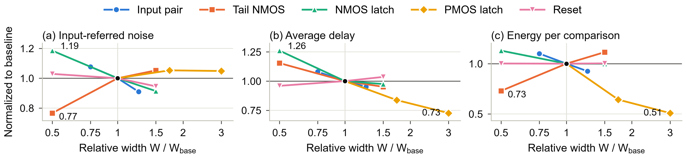

# ICEIC 2027 Draft (English) — StrongARM Latch Comparator Sizing Sensitivity (2 pages)

> **표기 규칙**
> - **[TBD: …]** — 채울 값 (PDF·Word에서 노란색)
> - **[CHECK: …]** — 확인이 필요한 문장·수치 (PDF·Word에서 청록색)
>
> Word: [ICEIC2027_draft_en.doc](ICEIC2027_draft_en.doc) — 양식 .doc의 서식을 그대로 쓴 제출용 원고
> 조판본: [ICEIC2027_draft_en.pdf](ICEIC2027_draft_en.pdf) — 위 Word 원고를 PDF로 내보낸 2쪽
> 한국어판: [ICEIC2027_draft_ko.md](ICEIC2027_draft_ko.md) · [.pdf](ICEIC2027_draft_ko.pdf) · [.doc](ICEIC2027_draft_ko.doc)

---

## Part 1. 검토 메모 (영문판)

### 1. 한국어판과의 관계

내용은 한국어판과 같습니다. 빈칸(노란색)의 자리도 한국어판과 같습니다. 이번 개정에서 바뀐 점, 수치 출처, 해석할 때 주의할 점은 한국어판 검토 메모 1·3·5절을 보세요.

### 2. 영문판에서 정한 것

| 항목 | 영문판 | 확인할 점 |
|---|---|---|
| 제목 | Transistor Sizing Sensitivity Analysis of a StrongARM Latch Comparator for a 10-bit SAR ADC (구성안 제목) | 24pt에서 3줄이 되고 마지막 줄에 "ADC"만 남습니다. 2줄로 줄이려면 "Sizing Sensitivity of a StrongARM Latch Comparator for a 10-bit SAR ADC"를 제안합니다. |
| 저자 이름 | Dongui Hong, Min Kim, Doohyung Kim, Sangyun Kim, Wooeun Choi | 이전 초안과 같은 추정 표기입니다(청록색). 각자 쓰는 영문 이름으로 바꿔 주세요. |
| 소속 | School of Electrical and Electronics Engineering, Chung-Ang University, Seoul, Republic of Korea | 학부의 공식 영문 명칭인지 확인해 주세요. |
| 초록 | 107단어 | 구성안 목표(80–110단어) 안입니다. |
| 그림·표 번호 | 양식의 자동 번호(Fig. 1., TABLE I.) | Word에서 캡션 앞 번호는 자동으로 붙습니다. |
| 사사 | 양식의 영문 문구 그대로 | — |

### 3. 분량

Word 기준 **2쪽 안에 들어가고**, 2쪽 끝에 약 3줄(약 34 pt)이 남습니다. 제목을 2줄로 줄이면 약 2줄이 더 남습니다. 넘칠 때 줄일 순서는 한국어판 검토 메모 2절과 같습니다.

### 4. 용어 대응

| 한국어판 | 영문판 |
|---|---|
| 명목 판정 중심 *μ* | nominal decision center *μ* |
| 입력 환산 잡음 *σ* | input-referred noise *σ* |
| 평균 지연 / 비교당 에너지 | average delay / energy per comparison |
| 입력 쌍, tail NMOS, NMOS 래치, PMOS 래치, 리셋 그룹 | input pair, tail NMOS, NMOS latch, PMOS latch, reset group |
| 내부 판정 마감 | internal decision deadline |
| 잡음 대역 2.4 GHz | 2.4-GHz noise bandwidth |
| 잡음 판정 기준(counter threshold) | noise-counter threshold |

---

## Part 2. 원고 초안 (English)

# Transistor Sizing Sensitivity Analysis of a StrongARM Latch Comparator for a 10-bit SAR ADC

**Authors** (all *School of Electrical and Electronics Engineering*, *Chung-Ang University*, Seoul, Republic of Korea; 3 in the first row · 2 in the second) — 영문 이름 표기는 확인 필요

| Dongui Hong (홍동의) | Min Kim (김민) | Doohyung Kim (김두형) |
|:---:|:---:|:---:|
| darwin5991@cau.ac.kr | kimminjoshua@cau.ac.kr | engud5027@naver.com |

| Sangyun Kim (김상윤) | Wooeun Choi (최우은) |
|:---:|:---:|
| goodalbert@naver.com | w030901@naver.com |

---

**Abstract** — This paper presents a StrongARM latch comparator for a 10-bit SAR ADC in 500-nm CMOS and analyzes how its input-referred noise, average delay, and energy per comparison depend on the widths of five device groups. Widening the PMOS latch from 1.6 to 4.8 µm reduced the average delay by 27.4% and the energy by 49.2%, whereas narrowing the tail NMOS reduced the noise and energy but lengthened the delay. After layout, the baseline showed a decision center of 177.3 µV and a noise of 123.3 µV rms, within the accuracy targets. The results show that accuracy, speed, and energy should be weighed together when sizing each group.

## I. Introduction

A successive-approximation-register (SAR) analog-to-digital converter (ADC) performs a binary search with one comparator, whose noise, offset, and delay directly limit the accuracy and speed of the ADC. The StrongARM latch draws no static current and regenerates a small input difference through positive feedback, which suits SAR ADCs [1], [2]. However, the size of each device group changes the current drive, regeneration speed, and parasitic capacitance together, so widening a device does not improve every metric [2], and the noise of regenerative comparators needs a separate analysis [3].

In this work, the targets were set with reference to a 10-bit, 1-MS/s SAR ADC [4], a baseline with a StrongARM core and an SR latch was designed, the widths of five device groups were varied one at a time to analyze the noise, delay, and energy sensitivities, and the baseline was verified after layout and parasitic extraction (PEX).

## II. Circuit Design and Specifications

The application follows only the resolution and conversion rate of the SAR ADC in [4]. The comparator uses a 500-nm CMOS process, a 5-V supply, and a 2.5-V input common-mode voltage; with a 2.5-V differential full scale, 1 LSB is *V*FS,diff/210 = 2.5 V/1024 ≈ 2.441 mV. The nominal decision center was targeted at |*μ*| ≤ 0.5 LSB (1.221 mV) and the input-referred noise at *σ* ≤ 0.1 LSB (244.1 µV rms), which limits the SNR degradation by noise independent of the quantization noise to about 0.5 dB. For characterization, an 80-MHz clock (50% duty cycle), separate from 1-MS/s operation, was used with an internal decision deadline 5 ns after the rising edge (80% of the high phase).

In the comparator of Fig. 1, the reset phase initializes nodes P/Q and X/Y; in the evaluation phase, the cross-coupled latch regenerates the voltage difference developed at X/Y into a decision, which the SR latch holds. The baseline widths are 6.4 µm for the input pair; 3.2 µm for the tail NMOS, NMOS latch, and reset group (P/Q and X/Y resets changed together); and 1.6 µm (the process minimum) for the PMOS latch. Symmetric devices are sized identically, with the channel length fixed at **[TBD: L]** µm.

> **[Fig. 1 placeholder · 32 mm high]** StrongARM core + SR latch schematic · Mark the five sizing groups · W (µm) of each transistor · Label nodes X/Y, P/Q, CLK, inputs and outputs
>
> Fig. 1. Schematic of the comparator (StrongARM core and SR latch) with the five sizing groups (widths in µm, *L* = **[TBD]** µm).

## III. Simulation Results and Discussion

### A. Transistor Sizing Sensitivity

One group at a time was resized with the others at the baseline, giving 15 schematic-level conditions: 4.8/6.4/8.0 µm for the input pair, 1.6/2.77/4.8 µm for the PMOS latch, and 1.6/3.2/4.8 µm for the other groups. In transient noise simulations with a 2.4-GHz noise bandwidth, *V*diff was swept from −1.2 to +1.2 mV in 40 points, and the probability of a high decision over 100 comparisons at each point was fitted by (1) to extract the nominal decision center *μ* and the rms input-referred noise *σ* [3].

$$
P(\mathrm{High}) = \Phi\!\left(\frac{V_{\mathrm{diff}}-\mu}{\sigma}\right) \tag{1}
$$

The delay was measured from the rising clock edge to the completion of the internal decision, and the energy per comparison from the supply power averaged over one clock period; both were averaged over the 40 points, which differs from the average energy of an actual ADC. The baseline showed *μ* = 15.1 µV, *σ* = 207.2 µV rms, a delay of 2.14 ns, and an energy of 28.6 pJ.

As shown in Fig. 2, widening the PMOS latch from 1.6 to 4.8 µm reduced the average delay by 27.4% and the energy by 49.2%, while the noise rose by only 4.9%. Narrowing the tail NMOS from 3.2 to 1.6 µm reduced the noise by 23.4% and the energy by 27.1% but increased the delay by 15.4%. Narrowing the NMOS latch to 1.6 µm increased the noise, delay, and energy by 18.5%, 26.1%, and 13.0%, and its noise of 245.5 µV rms slightly exceeded the 0.1-LSB target. Widening the input pair to 8.0 µm improved all three metrics by less than 10%, and the reset group changed the energy by less than 0.3%.

Fig. 2. (a) Input-referred noise, (b) average delay, and (c) energy per comparison versus the width of each device group, normalized to the baseline.

The energy reduction of the PMOS latch was also observed at fixed inputs of *V*diff = +0.2 mV (−51.3%) and +1.0 mV (−45.9%). Re-measuring the NMOS latch with a modified noise-counter threshold gave the same trend (244.8/206.4/189.3 µV rms), and a 5.19-ns delay beyond the 5-ns deadline, seen once at 1.6 µm, did not recur in a rerun. In all 15 conditions, |*μ*| ≤ 15.4 µV, far below the 0.5-LSB target (random offset due to mismatch excluded).

### B. Post-Layout Verification of the Baseline

The baseline StrongARM core was laid out (Fig. 3) and simulated with its extracted parasitic resistance and capacitance and the schematic SR latch. Over 60 *V*diff points, the decision center was 177.3 µV (0.073 LSB) and the input-referred noise 123.3 µV rms (0.050 LSB), meeting the accuracy targets (Table I). Because the pre- and post-layout conditions differ, their difference is not attributed directly to the parasitics, and since delays above 5 ns were observed in earlier post-layout runs, the timing target is not claimed.

> **[Fig. 3 placeholder | Table I (right)]** Baseline StrongARM core layout · Scale bar · width × height (µm) · (86 × 33 mm)
>
> Fig. 3. Layout of the baseline StrongARM core (**[TBD]** µm × **[TBD]** µm).

**TABLE I. Baseline Performance Summary**

| Metric | Pre-layout | Post-layout |
|---|:---:|:---:|
| Decision center *μ* (µV) | 15.1 | 177.3 |
| Input-referred noise *σ* (µV rms) | 207.2 | 123.3 |
| Average delay (ns)a | 2.14 | **[TBD]** |
| Energy per comparison (pJ)a | 28.6 | **[TBD]** |

a Mean over *V*diff = −1.2 to +1.2 mV (40 points pre-layout, 60 points post-layout).

## IV. Conclusion

Analyzing the width sensitivity of five device groups of a StrongARM comparator showed that widening the PMOS latch greatly reduces the delay and energy, narrowing the tail NMOS trades delay for lower noise and energy, and excessively narrowing the NMOS latch degrades all three metrics. All sizing conditions and the post-layout baseline met the decision-center target. These results show that accuracy, speed, and energy should be considered together when sizing each device group.

## Acknowledgment

This paper was supported by Korea Institute for Advancement of Technology (KIAT) grant funded by the Korea Government (Ministry of Education) (P0030093, “Semiconductor”-Specialized University).

## References

[1] B. Razavi, “The StrongARM latch [A circuit for all seasons],” *IEEE Solid-State Circuits Mag.*, vol. 7, no. 2, pp. 12–17, Spring 2015.

[2] B. Razavi, “The design of a comparator [The analog mind],” *IEEE Solid-State Circuits Mag.*, vol. 12, no. 4, pp. 8–14, Fall 2020.

[3] P. Nuzzo, F. De Bernardinis, P. Terreni, and G. Van der Plas, “Noise analysis of regenerative comparators for reconfigurable ADC architectures,” *IEEE Trans. Circuits Syst. I, Reg. Papers*, vol. 55, no. 6, pp. 1441–1454, Jul. 2008.

[4] D. Verma *et al.*, “A design of low-power 10-bit 1-MS/s asynchronous SAR ADC for DSRC application,” *Electronics*, vol. 9, no. 7, Art. no. 1100, Jul. 2020.
