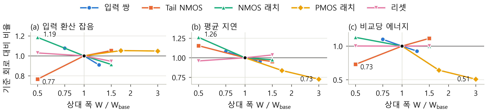

# ICEIC 2027 초안 (한국어 검토용) — StrongARM 래치 비교기 사이징 민감도 (2페이지)

> **표기 규칙**
> - **[TBD: …]** — 채울 값 (PDF·Word에서 노란색)
> - **[CHECK: …]** — 확인이 필요한 문장·수치 (PDF·Word에서 청록색)
>
> Word: [ICEIC2027_draft_ko.doc](ICEIC2027_draft_ko.doc) — 양식 .doc의 서식을 그대로 쓴 원고
> 조판본: [ICEIC2027_draft_ko.pdf](ICEIC2027_draft_ko.pdf) — 위 Word 원고를 PDF로 내보낸 2쪽 (검토 메모는 이 .md에만 있음)
> 영문판: [ICEIC2027_draft_en.md](ICEIC2027_draft_en.md) · [.pdf](ICEIC2027_draft_en.pdf) · [.doc](ICEIC2027_draft_en.doc)
> 사이징 결과 정리: [sim_result/sizing_sweep_results.md](sim_result/sizing_sweep_results.md)

---

## Part 1. 검토 메모

### 1. 이번 개정에서 바뀐 점 (최종 구성안 반영)

이전 초안의 검토 메모(ChatGPT 대화 반영표, 판정 시점 문제 등)는 이번 개정으로 대부분 정리되어 뺐습니다. 이전 내용은 git 기록에 있습니다.

| 항목 | 이전 초안 | 이번 초안 |
|---|---|---|
| 제목 | SAR ADC 응용을 위한 … 크기 민감도 및 성능 분석 | 구성안 제목: 10비트 SAR ADC용 StrongARM 래치 비교기의 트랜지스터 크기 민감도 분석 |
| 사이징 방법 | 0.5×/2× (가정) | 실제 스윕: 그룹마다 폭 3개, 15개 조건. 리셋은 P/Q와 X/Y를 한 그룹으로 |
| 측정 조건 | 비교 횟수 **[TBD: N]** | ±1.2 mV 40개 지점, 지점당 100회, 잡음 대역 2.4 GHz |
| 사이징 결과 | **[TBD]** 문장 3개 | PMOS 래치 → tail → NMOS 래치 → 입력 쌍·리셋 순서로 실제 수치 기입 |
| 그림 2 | 자리만 있음 | 실제 데이터로 그린 정규화 민감도 그림 |
| 그림 1 / 그림 3 | (a) 회로도 + (b) 레이아웃 / post-layout CDF | 그림 1 = 회로도, 그림 3 = 레이아웃 (CDF 그림은 뺌) |
| 표 1 pre-layout | 8.4 µV, 142.6 µV, 지연·에너지 **[TBD]** | 사이징 스윕의 기준 회로 값: 15.1 µV, 207.2 µV rms, 2.14 ns, 28.6 pJ |
| 표 1 post-layout 지연·에너지 | 그래프 판독값 4.5–5.7 ns, 37–77 pJ | **[TBD]** (구성안대로 최종 집계 조건을 정한 뒤 기입) |
| 판정 시점 | 12 MHz 조건과 비교 | 80 MHz는 별도 평가 조건, 5 ns를 내부 판정 마감으로 정의. 시간 목표를 만족했다고 주장하지 않음 |
| post-layout 잡음 감소 해석 | X/Y 커패시턴스 때문으로 추정 | 삭제. pre/post 조건이 달라 직접 비교하지 않음 |
| 참고문헌 | [3] Liu et al.(50 MS/s), [4] Nuzzo | [3] Nuzzo, [4] Verma et al.(10비트 1 MS/s, Crossref로 서지 확인) |
| 추가 검증 | 없음 | PMOS 고정 입력 에너지, NMOS 재측정, 15개 조건의 판정 중심을 한 문단으로 |

### 2. 분량

- Word 기준 **2쪽 안에 들어가고**, 2쪽 끝에 약 2–3줄(약 32 pt)이 남습니다.
- 2쪽에 맞추느라 구성안보다 줄인 곳입니다.
  - 서론 3문단 → 2문단 (필요성 문단과 응용·목적 문단을 합침)
  - II장 LSB 식은 문장 안에 넣었고, 사양표는 넣지 않았습니다.
  - II장 문단 3(기준 회로 동작 확인)은 뺐습니다.
  - 추가 검증(PMOS, NMOS)과 판정 중심 분석은 III-A의 한 문단으로 합쳤습니다. PMOS 고정 입력 에너지는 pJ 값 대신 감소율만 적었습니다.
  - III-B의 "구현 검증의 의미" 문단은 결과 문단의 마지막 문장으로 합쳤습니다.
- 그림 1(32 mm)과 그림 3 + 표 1(33 mm)은 자리 크기 그대로입니다. 실제 그림이 더 크면 넘칩니다.
- 넘칠 때 줄일 순서입니다.
  1. III-A 마지막 문단의 NMOS 재측정 문장
  2. II장의 SNR 0.5 dB 문장
  3. 그림 2 높이 (스크립트의 `figsize` 높이를 1.5로)

### 3. 수치 출처

| 수치 | 출처 |
|---|---|
| 15개 조건의 *μ*, *σ* | [sim_result/results/f_prob/f_prob_summary.csv](sim_result/results/f_prob/f_prob_summary.csv) (CDF 피팅) |
| 지연·에너지 평균과 변화율 | `sim_result/*_sweep.csv`의 40개 DIFF 지점 산술평균 ([sizing_sweep_results.md](sim_result/sizing_sweep_results.md) 4.1절) |
| 그림 2 데이터 | [sim_result/results/fig2/fig2_data.csv](sim_result/results/fig2/fig2_data.csv) |
| PMOS 고정 입력 에너지, NMOS 재측정 *σ*, 재실행 timeout 결과 | 최종 구성안 (원본 데이터는 저장소에 없음) |
| Post-layout *μ*, *σ* | 최종 구성안 (177.292 µV, 123.262 µV rms) |
| 참고문헌 [4] 서지 | Crossref (DOI 10.3390/electronics9071100, 2020년 7월, 저자 9명) |

### 4. 채워야 할 빈칸 (노란색)

- [ ] 채널 길이 *L* (II장, 그림 1 캡션)
- [ ] Post-layout 평균 지연·비교당 에너지 (표 1)
- [ ] 레이아웃 크기 (그림 3 캡션)
- [ ] 그림 1 회로도, 그림 3 레이아웃 이미지 (자리 상자를 이미지로 바꾸기)

### 5. 확인할 점

- **잡음 변화의 통계 오차.**
  - DIFF당 100회라 *σ* 추정 오차가 약 ±5%(1σ)입니다([sizing_sweep_results.md](sim_result/sizing_sweep_results.md) 5.1절).
  - PMOS +4.9%, 입력 쌍 −9.1%, 리셋 ±5%는 이 오차 범위 안입니다. 그래서 본문에서는 "4.9%에 그쳤다", "10% 이내로 개선" 정도로만 썼습니다.
  - 오차보다 확실히 큰 잡음 변화는 tail 0.5×와 NMOS 래치 0.5×뿐입니다.
- **NMOS 래치 1.6 µm의 잡음.** 원래 측정 245.5 µV, 재측정 244.8 µV로 둘 다 목표(244.1 µV)보다 0.7–1.4 µV 큽니다. 차이가 오차보다 훨씬 작아서 "근소하게 넘었다"로 썼습니다. "목표 수준까지 커졌다"로 바꿔도 됩니다.
- **"15개 조건".** 5개 그룹 × 폭 3개라서 기준 회로가 다섯 번 들어갑니다(서로 다른 회로는 11개). 구성안 표현을 따랐습니다.
- **용어.** "잡음 대역 2.4 GHz"는 transient noise의 noise fmax 설정을 옮긴 것입니다. 지연 정의(클록 상승 → 내부 판정 완료)와 에너지 정의(한 주기 평균 공급 전력)는 구성안 문구를 따랐습니다.
- **지면이 남으면 넣을 수 있는 관찰.**
  - 에너지는 DIFF에 따라 평균 지연과 거의 같은 모양으로 변합니다(조건별 상관계수 0.97–0.999).
  - 이는 PMOS 래치를 키워 재생이 빨라진 것이 에너지 감소의 원인이라는 해석을 뒷받침합니다.
  - 원인을 확정하려면 StrongARM 코어와 SR 래치의 전원 전류를 따로 적분해 보세요.
- **제목 길이.** 한국어 제목은 2줄입니다. 영문 제목은 24pt에서 3줄이고 마지막 줄에 "ADC"만 남습니다(영문판 메모 2절).

### 6. 그림 2 다시 그리기

```
cd sim_result
python fig2_sizing_sensitivity.py
```

- `results/fig2/fig2_sizing_sensitivity_{ko,en}.png`가 600 dpi로 새로 만들어집니다.
- 크기는 7.0 × 1.62 in로 본문 폭과 같습니다. Word에서 폭을 본문 폭(약 178 mm)에 맞추면 글자가 8pt로 인쇄됩니다.
- 색 5개는 색각 이상 시뮬레이션 검사를 통과한 순서입니다. 흑백 인쇄에도 구분되도록 그룹마다 마커 모양을 다르게 했습니다.

---

## Part 2. 원고 초안

# 10비트 SAR ADC용 StrongARM 래치 비교기의 트랜지스터 크기 민감도 분석

**저자** (모두 *전자전기공학부*, *중앙대학교*, 서울, 대한민국; 첫 줄 3명 · 둘째 줄 2명)

| 홍동의 | 김민 | 김두형 |
|:---:|:---:|:---:|
| darwin5991@cau.ac.kr | kimminjoshua@cau.ac.kr | engud5027@naver.com |

| 김상윤 | 최우은 |
|:---:|:---:|
| goodalbert@naver.com | w030901@naver.com |

---

**초록** — 본 논문에서는 10비트 SAR ADC용 StrongARM 래치 비교기를 500 nm CMOS로 설계하고, 5개 소자 그룹의 폭에 따른 잡음, 평균 지연, 에너지의 민감도를 분석하였다. PMOS 래치의 폭을 1.6 µm에서 4.8 µm로 키우면 평균 지연이 27.4%, 에너지가 49.2% 줄었고, tail NMOS의 폭을 줄이면 잡음과 에너지는 줄었으나 지연이 늘었다. 레이아웃 후 기준 회로는 판정 중심 177.3 µV, 잡음 123.3 µV rms로 정확도 목표를 만족하였다. 이는 정확도, 속도, 에너지를 함께 고려한 그룹별 사이징이 필요함을 보여준다.

## I. 서론

SAR ADC는 비교기로 이진 탐색을 반복하므로 비교기의 잡음, 오프셋, 지연이 ADC의 정확도와 속도를 직접 제한한다. StrongARM 래치는 정적 전류가 없고 양의 피드백으로 작은 입력 차이를 재생하므로 SAR ADC에 적합하다 [1], [2]. 그러나 각 소자 그룹의 크기는 전류 구동, 재생 속도, 기생 커패시턴스를 함께 바꾸므로 폭을 키운다고 모든 성능이 좋아지지는 않으며 [2], 재생형 비교기의 잡음도 따로 분석해야 한다 [3].

본 논문에서는 10비트, 1 MS/s SAR ADC 사례 [4]를 참고해 목표를 정하고 StrongARM 코어와 SR 래치로 기준 회로를 설계한 뒤, 5개 소자 그룹의 폭을 하나씩 바꾸어 잡음, 지연, 에너지의 민감도를 분석하고 기준 회로를 레이아웃과 기생 성분 추출(PEX)로 검증하였다.

## II. 회로 설계 및 목표 사양

응용 환경은 10비트, 1 MS/s SAR ADC [4]의 해상도와 변환 속도만 참고해 정하였다. 공정은 500 nm CMOS, 전원은 5 V, 입력 공통 모드 전압은 2.5 V이고, 차동 full-scale 2.5 V에서 1 LSB는 *V*<sub>FS,diff</sub>/2<sup>10</sup> = 2.5 V/1024 ≈ 2.441 mV이다. 이에 따라 판정 중심은 |*μ*| ≤ 0.5 LSB(1.221 mV), 입력 환산 잡음은 *σ* ≤ 0.1 LSB(244.1 µV rms)를 목표로 하였으며, 잡음 목표는 양자화 잡음과 독립인 잡음에 의한 SNR 저하를 약 0.5 dB 이내로 제한한다. 특성 평가에는 1 MS/s 동작과 별개로 80 MHz(duty 50%) 클록을 쓰고, 클록 상승 후 5 ns(high 구간의 80%)를 내부 판정 마감으로 두었다.

그림 1의 비교기는 리셋 구간에 P/Q, X/Y를 초기화하고, 평가 구간에 X/Y 전압 차를 교차 결합 래치가 재생해 판정하며, SR 래치가 결과를 유지한다. 기준 폭은 입력 쌍 6.4 µm, tail NMOS·NMOS 래치·리셋(P/Q·X/Y 함께 변경) 3.2 µm, PMOS 래치 1.6 µm(최소 폭)이며, 대칭 소자는 같은 크기, 채널 길이는 **[TBD: L]** µm로 고정하였다.

> **[그림 1 자리 · 높이 32 mm]** StrongARM 코어 + SR 래치 회로도 · 5개 사이징 그룹 구분 · 각 트랜지스터 W(µm) 표기 · 노드 X/Y, P/Q, CLK, 입출력 이름 표기
>
> 그림 1. 설계한 비교기(StrongARM 코어 + SR 래치) 회로도와 5개 사이징 그룹 (폭 단위 µm, *L* = **[TBD]** µm).

## III. 시뮬레이션 결과 및 분석

### A. 트랜지스터 크기 민감도

한 번에 한 그룹의 폭만 바꾸고 나머지는 기준 폭으로 두어, 입력 쌍 4.8/6.4/8.0 µm, PMOS 래치 1.6/2.77/4.8 µm, 나머지 그룹 1.6/3.2/4.8 µm의 15개 조건을 schematic 수준에서 시뮬레이션하였다. 과도 잡음 시뮬레이션(잡음 대역 2.4 GHz)에서 *V*<sub>diff</sub>를 −1.2~+1.2 mV의 40개 지점으로 바꾸고, 지점마다 100회 비교한 High 확률을 식 (1)로 피팅해 명목 판정 중심 *μ*와 입력 환산 잡음 *σ*를 구하였다 [3].

$$
P(\mathrm{High}) = \Phi\!\left(\frac{V_{\mathrm{diff}}-\mu}{\sigma}\right) \tag{1}
$$

지연은 클록 상승부터 내부 판정 완료까지의 시간, 에너지는 한 주기 평균 공급 전력으로 구한 비교당 에너지이며, 두 값은 40개 지점의 산술평균으로 요약하였다(실제 ADC의 평균 에너지와는 다름). 기준 회로는 *μ* = 15.1 µV, *σ* = 207.2 µV rms, 평균 지연 2.14 ns, 에너지 28.6 pJ이었다.

그림 2와 같이 PMOS 래치를 1.6 µm에서 4.8 µm로 키우면 평균 지연이 27.4%, 에너지가 49.2% 줄었고 잡음 증가는 4.9%에 그쳤다. Tail NMOS를 3.2 µm에서 1.6 µm로 줄이면 잡음이 23.4%, 에너지가 27.1% 줄었으나 지연은 15.4% 늘어 지표가 서로 반대로 움직였다. NMOS 래치를 1.6 µm로 줄이면 잡음, 지연, 에너지가 각각 18.5%, 26.1%, 13.0% 늘었고 잡음(245.5 µV rms)은 0.1 LSB 목표를 근소하게 넘었다. 입력 쌍을 8.0 µm로 키우면 세 지표가 모두 10% 이내로 개선되었고, 리셋 그룹의 에너지 변화는 0.3% 이내였다.



그림 2. 소자 그룹별 폭에 따른 (a) 입력 환산 잡음, (b) 평균 지연, (c) 비교당 에너지 (기준 회로 값으로 정규화).

PMOS 래치의 에너지 감소는 *V*<sub>diff</sub> = +0.2 mV(−51.3%)와 +1.0 mV(−45.9%)의 고정 입력에서도 확인되었다. NMOS 래치는 잡음 판정 기준을 바꿔 다시 측정해도 같은 경향(244.8/206.4/189.3 µV rms)을 보였고, 1.6 µm에서 한 번 관측된 5.19 ns 지연(5 ns 마감 초과)은 재실행에서 재현되지 않았다. 15개 조건 모두 |*μ*| ≤ 15.4 µV로 0.5 LSB 목표보다 충분히 작았다(소자 불일치에 의한 random offset은 제외).

### B. 기준 회로의 Post-Layout 검증

기준 StrongARM 코어를 레이아웃하고(그림 3) 추출한 기생 저항과 커패시턴스를 schematic SR 래치와 함께 시뮬레이션하였다. *V*<sub>diff</sub> 60개 지점에서 판정 중심은 177.3 µV(0.073 LSB), 입력 환산 잡음은 123.3 µV rms(0.050 LSB)로 정확도 목표를 만족하였다(표 1). Pre/post-layout은 측정 조건이 달라 그 차이를 PEX의 효과로 직접 해석하지 않으며, 이전 post-layout 결과에서 5 ns를 넘는 지연이 관측되어 시간 목표 만족은 주장하지 않는다.

> **[그림 3 자리 | 표 1 (오른쪽)]** 기준 StrongARM 코어 레이아웃 · 스케일 바 · 가로×세로 크기(µm) 표기 · (86 × 33 mm)
>
> 그림 3. 기준 회로의 StrongARM 코어 레이아웃 (**[TBD]** µm × **[TBD]** µm).

**표 1. 기준 회로 성능 요약**

| 성능 지표 | Pre-layout | Post-layout |
|---|:---:|:---:|
| 판정 중심 *μ* (µV) | 15.1 | 177.3 |
| 입력 환산 잡음 *σ* (µV rms) | 207.2 | 123.3 |
| 평균 지연 (ns)<sup>a</sup> | 2.14 | **[TBD]** |
| 비교당 에너지 (pJ)<sup>a</sup> | 28.6 | **[TBD]** |

<sup>a</sup> *V*<sub>diff</sub> = −1.2 ~ +1.2 mV 구간의 평균 (pre-layout 40개 지점, post-layout 60개 지점).

## IV. 결론

StrongARM 비교기의 5개 소자 그룹 폭에 대한 민감도 분석에서 PMOS 래치 확대는 지연과 에너지를 크게 줄였고, tail NMOS 축소는 잡음·에너지와 지연 사이의 trade-off를, NMOS 래치의 과도한 축소는 세 지표 모두의 악화를 보였다. 판정 중심 목표는 모든 조건과 post-layout 기준 회로에서 만족하였다. 따라서 그룹별 사이징에서는 정확도, 속도, 에너지를 함께 고려해야 한다.

## 사사

본 논문은 정부(교육부)의 재원으로 한국산업기술진흥원(KIAT)의 지원을 받아 수행된 연구임 (P0030093, 반도체 특성화대학 지원사업).

## 참고문헌

[1] B. Razavi, “The StrongARM latch [A circuit for all seasons],” *IEEE Solid-State Circuits Mag.*, vol. 7, no. 2, pp. 12–17, Spring 2015.

[2] B. Razavi, “The design of a comparator [The analog mind],” *IEEE Solid-State Circuits Mag.*, vol. 12, no. 4, pp. 8–14, Fall 2020.

[3] P. Nuzzo, F. De Bernardinis, P. Terreni, and G. Van der Plas, “Noise analysis of regenerative comparators for reconfigurable ADC architectures,” *IEEE Trans. Circuits Syst. I, Reg. Papers*, vol. 55, no. 6, pp. 1441–1454, Jul. 2008.

[4] D. Verma *et al.*, “A design of low-power 10-bit 1-MS/s asynchronous SAR ADC for DSRC application,” *Electronics*, vol. 9, no. 7, Art. no. 1100, Jul. 2020.
