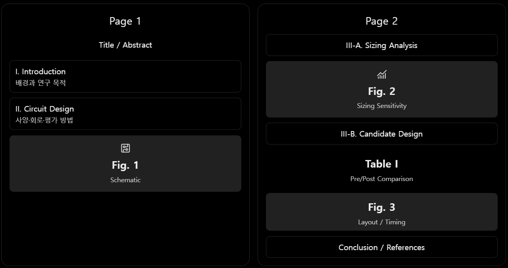

# ICEIC 2027 — 2페이지 논문 구성안

제목(안)

Sensitivity-Guided Transistor Sizing and Post-Layout Verification of a StrongARM Comparator for SAR ADC Applications

논문 흐름: 응용 사양 설정 → StrongARM 설계 → 개별 Sizing 분석 → Candidate 선정 → Pre/Post-Layout 비교 → 결론

# Page 1 — 연구 배경 및 회로 설계

## Abstract

- 10-bit SAR ADC 응용을 위한 StrongARM Comparator 설계 및 Sizing 분석.
- 500 nm CMOS에서 5개 소자 그룹의 Noise·Delay·Energy 민감도 평가.
- 분석 결과를 바탕으로 Input Pair와 PMOS Latch의 Width를 조합한 Candidate 설계.
- Pre-Layout: 평균 Delay 31.11%, Energy 50.42% 감소.
- Post-Layout: 평균 Delay 17.77%, Energy 40.76% 감소.
- Sizing 분석 기반 설계 개선 효과가 PEX 이후에도 유지됨을 확인.

## I. Introduction

문단 1 — 배경 및 필요성

- SAR ADC에서 Comparator의 Noise·Offset·Delay·Energy가 중요함.
- StrongARM Latch는 정적 전력 소비가 없는 동적 비교기 구조 [1], [2].
- 소자 크기에 따라 Regeneration, Noise, Delay 및 소비 에너지가 변화하므로 Sizing 분석이 필요함 [2], [3].

문단 2 — 연구 목적

- 10-bit, 1-MS/s SAR ADC 응용 사례 [4]를 참고.
- 주요 소자 그룹의 성능 민감도 분석.
- 분석 결과로 Candidate를 선정하고 Pre/Post-Layout에서 성능 개선 여부 검증.

## II. Circuit Design and Specifications

문단 1 — 설계 사양

- 500 nm CMOS, \\(V\_{DD}=5\\) V, \\(V\_{CM}=2.5\\) V.
- 10-bit SAR ADC, 차동 Full-scale 2.5 V 가정.
- 1 LSB = 2.441 mV.
- Nominal Decision Center 목표: \\(|\mu|\leq1.221\\) mV.
- Input-referred Noise 목표: \\(\sigma\leq244.14\\) µV RMS.
- 80 MHz 시험 Clock에서 내부 판정 시간 목표 5 ns.
- 해상도·속도는 [4]를 참고하고, 입력 범위와 Noise·Timing 예산은 자체 설정.

문단 2 — 회로 구조

- StrongARM Core + SR Latch 구성.
- Input Pair, Tail, NMOS Latch, PMOS Latch, Reset 그룹으로 구분.
- Channel Length 0.5 µm 고정, Width만 변화.

Fig. 1. StrongARM Comparator Schematic

- StrongARM + SR Latch 회로도.
- 5개 Sizing 그룹 및 Candidate 변경 부분 표시.

문단 3 — 시뮬레이션 방법

- DIFF = −1.2\~+1.2 mV, 40개 지점, 각 100회 비교.
- Gaussian CDF 피팅으로 \\(\mu\\), \\(\sigma\\) 추출.
- Internal Decision Delay와 Energy/Comparison 측정.
- Delay·Energy는 40개 DIFF 지점의 동일 가중치 산술평균.

# Page 2 — 실험 결과 및 결론

## III. Simulation Results and Discussion

### A. Transistor Sizing Sensitivity Analysis

문단 1 — 개별 Sizing 분석

- 5개 소자 그룹, 그룹별 3개 Width 조건.
- 하나의 그룹만 변경하고 나머지는 Baseline 유지.
- Noise·Delay·Energy의 상대 변화율 분석.

문단 2 — 주요 실측 결과

| 변경 조건 (µm)           | Noise  | Delay  | Energy |
| -------------------- | ------ | ------ | ------ |
| Input 6.4 → 8.0      | −9.1%  | −4.9%  | −7.5%  |
| Tail 3.2 → 1.6       | −23.4% | +15.4% | −27.1% |
| NMOS Latch 3.2 → 1.6 | +18.5% | +26.1% | +13.0% |
| PMOS Latch 1.6 → 4.8 | +4.9%  | −27.4% | −49.2% |
| Reset 3.2 → 4.8      | −5.4%  | +3.6%  | +0.3%  |

- PMOS Latch 증가 시 Delay·Energy 크게 개선.
- Tail NMOS에서 Noise·Energy와 Delay 간 Trade-off 확인.
- Input Pair 증가 시 Noise·평균 Delay·Energy 개선.
- 모든 Sizing 조건의 명목 판정 중심이 15.4 µV 이내.

Fig. 2. Normalized Transistor Sizing Sensitivity

- (a) Noise, (b) Delay, (c) Energy.
- 5개 그룹의 Width별 결과를 Baseline = 1로 정규화.

### B. Sensitivity-Guided Candidate Design

문단 1 — Candidate 선정

- PMOS Latch와 Input Pair의 Sizing 분석 결과를 조합.
- Input Pair: 6.4 → 8.0 µm.
- PMOS Latch: 1.6 → 4.8 µm.
- 나머지 그룹은 Baseline 유지.

문단 2 — Pre-Layout 비교

- Candidate에서 Noise 2.40%, 평균 Delay 31.11%, Energy 50.42% 감소.
- 명목 판정 중심과 Noise 목표 만족.
- Sizing 분석 기반 Candidate의 성능 개선 확인.

### C. Post-Layout Verification

문단 1 — 구현 및 비교

- Baseline과 Candidate의 StrongARM Core Layout 및 PEX 수행.
- 동일한 Schematic SR Latch와 평가 조건 사용.
- Delay·Energy·Noise·판정 중심 및 5 ns Timeout 비교.

Table I. Pre- and Post-Layout Performance Comparison

| 항목              | Pre Baseline | Pre Candidate | Post Baseline | Post Candidate |
| --------------- | ------------ | ------------- | ------------- | -------------- |
| μ (µV)          | 13.06        | 12.19         | 248.62        | 18.59          |
| σ (µV RMS)      | 206.44       | 201.48        | 95.93         | 60.02          |
| Avg. Delay (ns) | 2.137        | 1.472         | 5.023         | 4.130          |
| E_comp (pJ)     | 28.646       | 14.202        | 54.537        | 32.305         |

문단 2 — Post-Layout 결과

- 평균 Delay 17.77% 감소, Energy 40.76% 감소.
- Pre-Layout보다 개선 폭은 감소했지만 개선 경향 유지.
- Noise·명목 판정 중심은 두 회로 모두 설정 목표 만족.
- Noise 감소는 관측 결과로 제시하되 Seed별 변동을 고려하여 통계적 개선으로 단정하지 않음.
- 판정 경계 부근의 최대 Timeout: Baseline 약 100회 → Candidate 약 38회/100회.
- 최대 Invalid: 약 28회 → 2회/100회.
- 모두 그래프 판독값이며, 5 ns Timing 위반은 Candidate에서도 발생함.

Fig. 3. Post-Layout Comparison

- (a) Baseline과 Candidate Layout.
- (b) 두 회로의 Timeout vs. DIFF 비교.

지면 부족 시 Layout 이미지만 배치하고 Timeout 결과는 본문에 기재.

## IV. Conclusion

- 5개 소자 그룹의 Sizing에 따른 Noise·Delay·Energy 민감도와 Trade-off 분석.
- Sizing 결과를 기반으로 Input Pair와 PMOS Latch 조합 Candidate 설계.
- Pre-Layout: Delay 31.11%, Energy 50.42% 감소.
- Post-Layout: Delay 17.77%, Energy 40.76% 감소.
- 5 ns Timeout 및 출력 Invalid 발생도 감소했으나 Timing 목표를 완전히 만족하지는 못함.
- Sizing 민감도 분석을 활용한 설계 개선 효과가 Post-Layout에서도 유지됨을 확인.

## References

- [1] B. Razavi, “The StrongARM Latch,” IEEE Solid-State Circuits Magazine, 2015.
- [2] B. Razavi, “The Design of a Comparator,” IEEE Solid-State Circuits Magazine, 2020.
- [3] P. Nuzzo et al., “Noise Analysis of Regenerative Comparators for Reconfigurable ADC Architectures,” IEEE TCAS-I, 2008.
- [4] D. Verma et al., “A Design of Low-Power 10-bit 1-MS/s Asynchronous SAR ADC for DSRC Application,” Electronics, 2020.

## 최종 2페이지 배치

핵심 그림은 Fig. 2, 핵심 표는 Table I이야. 나머지 내용은 이 두 결과가 자연스럽게 연결되도록 최소한으로 작성하면 2페이지 논문의 구조가 완성돼.