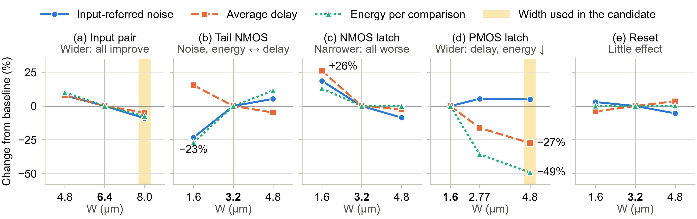

# 포스터 원고 — 영어판(ICEIC 2027, A0)과 한글판(성과교류회, A1)

- 기준 문서: 영어판은 `ICEIC2027_English_2pages_v2_final.doc`, 한글판은 `ICEIC2027_Korean_2pages_v2.doc` (문장, 수치, 용어). 두 논문의 수치는 모두 같다(맨 아래 "한글판 메모").
- 규격: 영어판은 A0 세로 84.1 × 118.9 cm(IEIE 2026 Summer 양식 × √2), 한글판은 양식 크기 그대로 A1 세로 59.4 × 84.1 cm. 한글판 상자 위치와 크기는 영어판의 1/√2배다.
- 블록 이름과 순서는 `poster_prompt.md` 4번(①–⑨)을 그대로 따른다. 한글판은 나중에 같은 구조로 블록마다 한글 원고만 채우면 된다.
- 이 파일에서 포스터에 실제로 들어가는 글은 영어판 `<!-- poster -->` … `<!-- /poster -->`, 한글판 `<!-- poster-ko -->` … `<!-- /poster-ko -->` 사이에 있는 것뿐이다. ⑧·⑨는 두 판이 같은 영어 문구를 쓴다. 그 밖의 한글 메모는 배치와 확인용이다.
- **굵은 글씨**는 디자인 단계에서 강조할 핵심 수치다. `[강조 후보]` 표시는 크게 키울 후보다.

---

## ① Header

<!-- poster -->
**Sensitivity-Guided Transistor Sizing and Post-Layout Verification of a StrongARM Comparator for 10-bit SAR ADC Applications**

Dongui Hong, Min Kim, Doohyeong Kim, Sangyun Kim, Wooeun Choi, and Yunjae Lee

School of Electrical and Electronics Engineering, Chung-Ang University, Seoul, Korea
<!-- /poster -->

한글판 (성과교류회)

<!-- poster-ko -->
**10-bit SAR ADC용 StrongARM 비교기의 민감도 기반 트랜지스터 크기 선정 및 레이아웃 후 검증**

홍동의, 김민, 김두형, 김상윤, 최우은, and 이윤재

School of Electrical and Electronics Engineering, Chung-Ang University, Seoul, Korea
<!-- /poster-ko -->

- 양식의 헤더 상자, CAU 로고(왼쪽 위), IEIE 로고(오른쪽 위)는 그대로 둔다.
- 글자 크기: 제목 85 pt, 저자·소속 45 pt (양식 60 pt, 32 pt의 √2배).
- 저자는 논문 6명, 논문 순서. 마지막 저자 앞의 "and"는 양식 표기를 따랐다.

---

## ② Abstract

<!-- poster -->
This work analyzes the sensitivity of noise, decision delay, and energy to the sizing of five transistor groups in a StrongARM comparator for SAR ADCs in a 500-nm CMOS process. Based on the analysis, an improved circuit with wider input-pair and PMOS-latch transistors was designed. Compared with the baseline, it reduced the average decision delay and energy per comparison by **31.11%** and **50.42%** in pre-layout simulation and by **17.77%** and **40.76%** in post-layout simulation, showing that the improvement is preserved after parasitic extraction.
<!-- /poster -->

한글판 (성과교류회)

<!-- poster-ko -->
본 연구에서는 500-nm CMOS 공정의 SAR ADC용 StrongARM 비교기를 대상으로 5개 트랜지스터 그룹의 Sizing에 따른 잡음, 판정 지연 및 에너지 민감도를 분석하였다. 분석 결과를 바탕으로 Input Pair와 PMOS Latch의 폭을 증가시킨 개선 회로를 설계하였다. 개선 회로는 Baseline 대비 평균 판정 지연과 비교당 에너지를 Pre-Layout에서 각각 **31.11%**, **50.42%**, Post-Layout에서 각각 **17.77%**, **40.76%** 감소시켜, 민감도 분석에 기반한 Sizing의 개선 효과가 기생성분 추출 이후에도 유지됨을 확인하였다.
<!-- /poster-ko -->

- 논문 초록 4문장을 3문장으로 줄였다. 둘째 문장의 "and its performance was verified through pre- and post-layout simulations"를 빼고(셋째 문장에 Pre/Post 결과가 있음), 넷째 문장은 셋째 문장 끝에 "showing that …"으로 붙였다. 핵심 수치 네 개는 모두 남겼다.

---

## ③ Introduction

<!-- poster -->
- A SAR ADC determines its output through repeated comparisons, so comparator noise, delay, and energy affect its accuracy and efficiency.
- The StrongARM latch is a dynamic comparator with low static power consumption [1], [2]; its transistor sizes trade off noise, decision delay, and power [2], [3].
- This work: sizing sensitivity of five transistor groups → improved circuit → pre- and post-layout verification.
<!-- /poster -->

한글판 (성과교류회)

<!-- poster-ko -->
- SAR ADC는 반복적인 비교로 출력을 결정하므로, 비교기의 잡음, 지연 및 에너지가 정확도와 동작 효율에 영향을 미친다.
- StrongARM Latch는 낮은 정적 전력 소모를 특징으로 하는 동적 비교기 구조이며[1], [2], 트랜지스터 크기는 잡음, 판정 지연 및 전력 소비 사이의 Trade-off에 영향을 미친다[2], [3].
- 본 연구: 5개 트랜지스터 그룹의 Sizing 민감도 분석 → 개선 회로 설계 → Pre-/Post-Layout 검증.
<!-- /poster-ko -->

- 첫 bullet(SAR ADC에서 비교기의 역할)은 논문에 없고 `논문 구성안.md` I장 문단 1에서 가져왔다. 둘째·셋째 bullet은 논문 서론 문장을 줄인 것이다.

---

## ④ Circuit Design and Evaluation Method

<!-- poster -->
**Design specifications**

| Item | Value |
|---|---|
| Process and supply | 500-nm CMOS, VDD = 5 V, VCM = 2.5 V |
| ADC assumption | 10-bit, differential full-scale 2.5 V, 1 LSB = 2.441 mV |
| Decision center | \|μ\| ≤ 0.5 LSB (1.221 mV) |
| Input-referred noise | σ ≤ 0.1 LSB (244.14 μV RMS) |
| Timing | 80-MHz clock, 5-ns decision deadline |

Resolution from [4]; full-scale range, noise, and timing budgets set in this work.

**StrongARM core and sizing groups**

StrongARM core (Fig. 1) + SR latch; five transistor groups are the sizing variables (L = 0.5 μm).

| Group | Devices | Baseline W (μm) |
|---|---|---|
| Input pair | M1, M2 | 6.4 |
| Tail NMOS | M7 | 3.2 |
| NMOS latch | M3, M4 | 3.2 |
| PMOS latch | M5, M6 | 1.6 |
| Reset | S1–S4 | 3.2 |

Fig. 1. Schematic of the StrongARM comparator core with the five transistor sizing groups.

**Evaluation method**

Baseline → Individual sweeps (15 conditions) → Improved-circuit selection → Pre-layout → Layout and PEX → Post-layout

- Transient noise: Vdiff = −1.2 to +1.2 mV, 40 points × 100 comparisons.
- μ and σ: Gaussian CDF fit, P(High) = Φ[(Vdiff − μ)/σ].
- Decision delay: clock rising edge → internal decision complete.
- Energy per comparison: average supply power × clock period.
- Delay and energy: arithmetic means over the 40 points.
<!-- /poster -->

한글판 (성과교류회)

<!-- poster-ko -->
**설계 사양**

| 항목 | 값 |
|---|---|
| 공정 및 전압 | 500-nm CMOS, VDD = 5 V, VCM = 2.5 V |
| ADC 조건 | 10-bit, 차동 Full-scale 2.5 V, 1 LSB = 2.441 mV |
| 판정 중심 | \|μ\| ≤ 0.5 LSB (1.221 mV) |
| 입력 환산 잡음 | σ ≤ 0.1 LSB (244.14 μV RMS) |
| Timing | 80-MHz Clock, 5-ns 판정 마감 |

해상도는 [4]를 참고, 입력 범위·잡음·Timing 예산은 자체 설정.

**StrongARM Core와 Sizing 그룹**

StrongARM Core(Fig. 1)와 SR Latch로 구성되며, 5개 트랜지스터 그룹을 Sizing 변수로 설정하였다(L = 0.5 μm 고정).

| 그룹 | 소자 | Baseline W (μm) |
|---|---|---|
| Input Pair | M1, M2 | 6.4 |
| Tail NMOS | M7 | 3.2 |
| NMOS Latch | M3, M4 | 3.2 |
| PMOS Latch | M5, M6 | 1.6 |
| Reset | S1–S4 | 3.2 |

Fig. 1. 5개 트랜지스터 Sizing 그룹으로 구성된 StrongARM 비교기 코어 회로도.

**평가 방법**

Baseline → 그룹별 개별 Sweep (15개 조건) → 개선 회로 선정 → Pre-Layout → Layout·PEX → Post-Layout

- Transient Noise: Vdiff = −1.2 ~ +1.2 mV, 40개 지점 × 100회 비교.
- μ, σ: Gaussian CDF 피팅, P(High) = Φ[(Vdiff − μ)/σ].
- 판정 지연: Clock 상승 에지 → 내부 판정 완료.
- 비교당 에너지: 평균 공급 전력 × Clock 주기.
- 지연과 에너지: 40개 지점의 산술평균.
<!-- /poster-ko -->

배치 메모

- Fig. 1(왼쪽, 폭 18 cm, 높이 12.9 cm)과 그룹 표(오른쪽, 폭 19.2 cm)를 나란히 놓고, 캡션은 둘 아래에 둔다.
- 사양 표의 머리글 행(Item | Value)은 포스터에서는 빼고 다섯 줄만 넣는다. 표 글자는 28 pt(A1판 20 pt).
- 흐름도 한 줄은 이번 초안에서는 글자와 화살표(→)로만 넣는다. 상자 모양 흐름도로 바꾸는 것은 디자인 단계에서 한다.
- **디자인 단계 메모:** Fig. 1 회로도 위에 다섯 그룹(Input pair, Tail NMOS, NMOS latch, PMOS latch, Reset)을 색이나 점선 상자로 표시하고, 개선 회로에서 바꾼 Input pair와 PMOS latch를 강조한다.

근거

- 사양 표: 논문 II장 + `논문 구성안.md` 3장 문단 1 + `README.md`. 1 LSB = 2.5 V / 1024 = 2.441 mV, 0.5 LSB = 1.221 mV, 0.1 LSB = 244.14 μV로 다시 계산해 확인했다.
- 그룹 표: 논문 II장의 Baseline 폭과 Fig. 1 회로도의 소자 이름. Cadence 캡처(`우은버전.docx`의 `image1.png`)와 대조해 확인했다. Cadence의 소자 번호는 다르지만(입력 M7·M9 6.4u, Tail M10 3.2u, NMOS Latch M6·M8 3.2u, PMOS Latch M2·M3 1.6u, Reset M0·M1·M4·M12 3.2u, 모두 l = 0.5u) 연결과 폭이 Fig. 1의 M1·M2 / M7 / M3·M4 / M5·M6 / S1–S4와 일치한다.
- 평가 방법: 논문 II장(80-MHz, 5-ns, Gaussian CDF 피팅) + `논문 구성안.md` 3장 문단 3(40개 지점, 100회, 지연·에너지 정의, 산술평균). 비교당 에너지는 원자료 CSV에서 `E_comp = 평균 전력 × 12.5 ns`인 것을 확인했다.

---

## ⑤ Transistor Sizing Sensitivity

<!-- poster -->

Fig. 2. Change from baseline in noise, average delay, and energy versus width (one group varied at a time, others at baseline; 15 conditions).

Representative changes from baseline

| Width change (μm) | Noise | Average delay | Energy |
|---|---|---|---|
| Input pair 6.4 → 8.0 | −9.1% | −4.9% | −7.5% |
| Tail NMOS 3.2 → 1.6 | −23.4% | +15.4% | −27.1% |
| NMOS latch 3.2 → 1.6 | +18.5% | +26.1% | +13.0% |
| PMOS latch 1.6 → 4.8 | +4.9% | **−27.4%** | **−49.2%** |
| Reset 3.2 → 4.8 | −5.4% | +3.6% | +0.3% |

- **PMOS latch** wider: largest delay and energy reduction, but noise increases.
- **Tail NMOS** narrower: trade-off between noise/energy and delay.
- **Input pair** wider: all three improve. NMOS latch narrower: all degrade. Reset: little effect.
- → **Input pair + PMOS latch** selected to improve delay and energy while compensating for the noise increase of the wider PMOS latch.
<!-- /poster -->

한글판 (성과교류회)

<!-- poster-ko -->

Fig. 2. 폭 변화에 따른 Baseline 대비 잡음, 평균 지연 및 에너지 변화율(한 그룹씩 변경하고 나머지는 Baseline 고정, 총 15개 조건).

대표 조건의 Baseline 대비 변화

| 폭 변경 (μm) | 잡음 | 평균 지연 | 에너지 |
|---|---|---|---|
| Input Pair 6.4 → 8.0 | −9.1% | −4.9% | −7.5% |
| Tail NMOS 3.2 → 1.6 | −23.4% | +15.4% | −27.1% |
| NMOS Latch 3.2 → 1.6 | +18.5% | +26.1% | +13.0% |
| PMOS Latch 1.6 → 4.8 | +4.9% | **−27.4%** | **−49.2%** |
| Reset 3.2 → 4.8 | −5.4% | +3.6% | +0.3% |

- **PMOS Latch** 폭 증가: 지연·에너지 감소 폭이 가장 크지만 잡음은 증가.
- **Tail NMOS** 폭 감소: 잡음·에너지와 지연 사이의 Trade-off.
- **Input Pair** 폭 증가: 잡음, 지연, 에너지 모두 감소. NMOS Latch 폭 감소: 모두 악화. Reset: 영향 작음.
- → **Input Pair + PMOS Latch**를 Sizing 대상으로 선정: PMOS Latch 폭 증가에 따른 잡음 악화를 보완하면서 지연과 에너지를 개선.
<!-- /poster-ko -->

배치 메모

- 이 블록이 핵심이므로 오른쪽 단 맨 위에 두고 Fig. 2를 단 폭 전체(약 39.6 cm)로 넣는다.
- 표의 변화율은 Sweep 실행의 Baseline 기준이다. Table I의 Pre-Layout Baseline과는 다른 실행이므로 두 표를 합치지 않는다.

근거

- Fig. 2: 논문 최종본에 들어간 그림 파일과 같은 파일이다(`options/option3_lines_en.png`, 최종본 docx의 `image2.png`와 MD5 일치). 캡션은 논문 캡션에서 패널 목록 "(a) input pair, … (e) reset"을 빼고(그림 안 패널 제목에 있음), 논문 III-A의 Sweep 조건(한 그룹씩 바꾸고 나머지는 Baseline, 15개 조건)을 붙였다.
- 대표 조건 표: `fig2_data.csv`에서 다시 읽어 소수 첫째 자리로 반올림했다. 프롬프트 표와 다섯 줄 모두 일치한다.
- bullet 1, 2, 3의 앞부분(Input pair)과 선정 이유(bullet 4): 논문 III-A 문장을 줄인 것이다. 수치는 바로 위 표에 있으므로 bullet에서는 뺐다. 1번의 "largest"는 논문의 "up to" 대신 쓴 표현으로, `fig2_data.csv`(15개 조건 중 지연·에너지 감소 폭 최대)와 `논문 구성안.md`("가장 큰 개선")로 확인했다.
- bullet 3의 뒷부분(NMOS latch, Reset): 논문 본문에는 없고 논문 Fig. 2의 패널 부제("Narrower: all worse", "Little effect")와 `sizing_sweep_results.md` 요약에서 가져왔다.

---

## ⑥ Improved Design and Post-Layout Verification

<!-- poster -->
**Pre-layout: improved circuit**

- Input pair 6.4 → 8.0 μm, PMOS latch 1.6 → 4.8 μm; other groups at baseline.
- Average delay **−31.11%**, energy per comparison **−50.42%** vs. baseline `[강조 후보]`; μ and σ satisfied the targets.

**Post-layout verification**

- Baseline and improved cores laid out separately and extracted (PEX); both use the same SR-latch schematic.

Fig. 3. StrongARM core layouts: (a) baseline, (b) improved circuit.

TABLE I. PRE- AND POST-LAYOUT PERFORMANCE OF THE BASELINE AND IMPROVED CIRCUITS

| Parameter | Pre: Baseline | Pre: Improved | Post: Baseline | Post: Improved |
|---|---|---|---|---|
| Decision center μ (μV) | 13.061 | 12.190 | 248.624 | 18.594 |
| Input-referred noise σ (μV RMS) | 206.440 | 201.476 | 95.927 | 60.016 |
| Average delay (ns) | 2.1366 | 1.4719 | 5.0227 | 4.1304 |
| Energy per comparison (pJ) | 28.646 | 14.202 | 54.537 | 32.305 |

- Average decision delay **−17.77%**, energy per comparison **−40.76%** vs. baseline `[강조 후보]`; μ and σ satisfied the targets.
- Limitation: the decision was not completed within 5 ns for some input conditions, so timing compliance could not be guaranteed under all conditions.
<!-- /poster -->

한글판 (성과교류회)

<!-- poster-ko -->
**Pre-Layout: 개선 회로**

- Input Pair 6.4 → 8.0 μm, PMOS Latch 1.6 → 4.8 μm; 나머지 그룹은 Baseline 유지.
- Baseline 대비 평균 지연 **−31.11%**, 비교당 에너지 **−50.42%** `[강조 후보]`; 판정 중심과 입력 환산 잡음 모두 목표 만족.

**Post-Layout 검증**

- Baseline과 개선 회로의 Core를 각각 레이아웃하고 기생성분 추출(PEX) 수행; 두 회로 모두 동일한 SR Latch Schematic 사용.

Fig. 3. StrongARM Core 레이아웃: (a) Baseline, (b) 개선 회로.

TABLE I. BASELINE과 개선 회로의 PRE-/POST-LAYOUT 성능 비교

| 항목 | Pre: Baseline | Pre: 개선 회로 | Post: Baseline | Post: 개선 회로 |
|---|---|---|---|---|
| 판정 중심 μ (μV) | 13.061 | 12.190 | 248.624 | 18.594 |
| 입력 환산 잡음 σ (μV RMS) | 206.440 | 201.476 | 95.927 | 60.016 |
| 평균 지연 (ns) | 2.1366 | 1.4719 | 5.0227 | 4.1304 |
| 비교당 에너지 (pJ) | 28.646 | 14.202 | 54.537 | 32.305 |

- Baseline 대비 평균 판정 지연 **−17.77%**, 비교당 에너지 **−40.76%** `[강조 후보]`; 판정 중심과 입력 환산 잡음 모두 목표 만족.
- 한계: 일부 입력 조건에서는 5 ns 이내에 판정이 완료되지 않아, 모든 조건에서의 Timing 만족을 보장하지는 못하였다.
<!-- /poster-ko -->

배치 메모

- Fig. 3은 레이아웃 캡처가 아직 없어서 회색 빈 상자 두 개(각 약 19 × 7.5 cm)에 "(a) Baseline layout — to be added", "(b) Improved circuit layout — to be added"라고만 적는다.
- `[강조 후보]` 네 수치(Pre −31.11% / −50.42%, Post −17.77% / −40.76%)는 이번 초안에서는 굵게만 한다. 크게 키우는 방식은 디자인 단계에서 정한다.
- Timeout·Invalid 횟수는 넣지 않는다(0번 표 결정).

근거

- 문장: 논문 III-B, III-C. Table I과 캡션: 논문 그대로.
- Table I 값은 CSV에서 다시 확인했다. μ와 σ는 `*_cdf_summary.csv`, 지연과 에너지는 원자료 CSV 40개 지점의 산술평균이고 논문 값과 모두 일치한다. 감소율도 다시 계산해 Pre −31.11% / −50.42%, Post −17.77% / −40.76%로 일치한다.

---

## ⑦ Conclusion

<!-- poster -->
- The sizing sensitivity of five transistor groups in a StrongARM comparator was analyzed, and an improved circuit was designed from the results.
- In post-layout simulation, the improved circuit reduced the average decision delay and energy per comparison by **17.77%** and **40.76%** vs. baseline.
- Although timing limitations remain under some input conditions, the improvement from sensitivity-guided sizing was preserved after parasitic extraction.
<!-- /poster -->

한글판 (성과교류회)

<!-- poster-ko -->
- StrongARM 비교기의 5개 트랜지스터 그룹에 대한 Sizing 민감도를 분석하고, 이를 바탕으로 개선 회로를 설계하였다.
- 개선 회로는 Post-Layout에서 Baseline 대비 평균 판정 지연과 비교당 에너지를 각각 **17.77%**, **40.76%** 감소시켰다.
- 일부 입력 조건에서 Timing 한계가 남아 있으나, 민감도 분석에 기반한 Sizing의 개선 효과가 기생성분 추출 이후에도 유지되었다.
<!-- /poster-ko -->

- 논문 결론 3문장을 bullet 3개로 옮기고 "respectively", "was confirmed to be" 같은 부분만 줄였다.

---

## ⑧ Acknowledgement

한글판도 같은 영어 문구를 쓴다.

<!-- poster -->
This paper was supported by Korea Institute for Advancement of Technology(KIAT) grant funded by the Korea Government(Ministry of Education) (P0030093, “Semiconductor”-Specialized University)
<!-- /poster -->

- 양식 문구를 그대로 둔다. 과제 번호 P0030093은 논문 사사와 같다. 논문 쪽은 "Technology (KIAT)", "Government (Ministry"처럼 괄호 앞을 띄우고 끝에 마침표가 있지만, 지시대로 양식 표기를 유지했다.
- 권장 배치에서는 ⑨ References와 한 상자로 묶어 왼쪽 단 맨 아래에 둔다(아래 "배치" 참고).

---

## ⑨ References

한글판도 같은 영어 문구를 쓴다.

<!-- poster -->
[1] B. Razavi, “The StrongARM latch [A circuit for all seasons],” IEEE Solid-State Circuits Mag., vol. 7, no. 2, pp. 12–17, Spring 2015.

[2] B. Razavi, “The design of a comparator [The analog mind],” IEEE Solid-State Circuits Mag., vol. 12, no. 4, pp. 8–14, Fall 2020.

[3] P. Nuzzo, F. De Bernardinis, P. Terreni, and G. Van der Plas, “Noise analysis of regenerative comparators for reconfigurable ADC architectures,” IEEE Trans. Circuits Syst. I, vol. 55, no. 6, pp. 1441–1454, Jul. 2008.

[4] D. Verma et al., “A design of low-power 10-bit 1-MS/s asynchronous SAR ADC for DSRC application,” Electronics, vol. 9, no. 7, Art. no. 1100, Jul. 2020.
<!-- /poster -->

- 논문 [1]–[4] 그대로(따옴표와 쪽 번호의 en dash까지 논문 docx와 같게 맞췄다).
- 양식에 이 상자가 없으므로 Acknowledgement 상자 안 아래쪽에 굵은 "References" 소제목을 달고 20 pt(A1판 14 pt)로 작게 넣는다. 따로 상자를 만들면 머리띠 높이만큼 약 3 cm가 더 든다.

---

## 배치: 왼쪽 단과 오른쪽 단

A0 기준 치수(양식 × √2): 헤더 상자 0.69–20.45 cm, 두 단은 각 폭 40.77 cm(왼쪽 x = 0.69 cm, 오른쪽 x = 42.59 cm), 세로 21.44–118.09 cm(96.65 cm), 상자 사이 간격 1.27 cm.

### 권장안: ⑧·⑨를 왼쪽 단 맨 아래로 (B단계 초안에 적용)

아래 높이는 `poster_draft_en.pptx`에서 PowerPoint로 잰 값이다(괄호 안은 A단계 추정값).

| 단 | 블록 | 예상 높이 (cm) | 단 높이 대비 |
|---|---|---|---|
| 왼쪽 | ② Abstract | 14.9 (15.0) | 15% |
| 왼쪽 | ③ Introduction | 13.8 (14.1) | 14% |
| 왼쪽 | ④ Circuit Design and Evaluation Method | 48.4 (48.5) | 50% |
| 왼쪽 | ⑧ Acknowledgement + ⑨ References (한 상자) | 15.7 (15.4) | 16% |
| 왼쪽 | 합계 (간격 포함) | 96.6 | 단 바닥까지 0.04 cm 남음 |
| 오른쪽 | ⑤ Transistor Sizing Sensitivity | 38.5 (38.4) | 40% |
| 오른쪽 | ⑥ Improved Design and Post-Layout Verification | 41.7 (41.4) | 43% |
| 오른쪽 | ⑦ Conclusion | 13.8 (14.1) | 14% |
| 오른쪽 | 합계 (간격 포함) | 96.6 | 단 바닥까지 0.07 cm 남음 |

- 읽는 순서는 ②→③→④(왼쪽), ⑤→⑥→⑦(오른쪽)로 논문 흐름과 같다. ⑧·⑨는 본문 흐름 밖이라 왼쪽 아래에 두어도 순서가 깨지지 않는다.
- A1 한글판은 모든 치수를 1/√2배 하면 된다.

### 기본안(왼쪽 ②–④, 오른쪽 ⑤–⑨)을 쓰면

- 왼쪽 80.2 cm(16.5 cm 남음), 오른쪽 116.6 cm(19.9 cm 넘침)이다. 기본안을 지키려면 오른쪽에서 약 20 cm를 더 빼야 한다. 예: 대표 조건 표 삭제(−8.5 cm, Fig. 2와 같은 데이터), Fig. 3 자리 삭제(−9.5 cm), Conclusion을 2 bullet로(−3 cm). 그래서 권장하지 않는다.

### 높이를 어떻게 추정했나

- Times New Roman의 실제 글자 폭으로 각 문단을 34 pt, 단 폭(39.1 cm, 여백 제외)에서 줄바꿈해 줄 수를 셌다. bullet은 들여쓰기 1 cm를 뺐다.
- 줄 높이는 글자 크기의 1.15배, 문단 사이 0.2 cm, 머리띠와 위 여백 3.0 cm, 아래 여백 0.8 cm로 잡았다. 같은 모델을 양식의 Abstract 상자(A1, 9줄)에 적용하면 11.46 cm로 실제 11.45 cm와 맞는다.
- 표 28 pt, 참고문헌 20 pt, Fig. 1 폭 20 cm, Fig. 2는 단 폭 전체(높이 12.3 cm), Fig. 3 자리 8 cm로 계산했다. B단계에서 넘침을 없애려고 Fig. 1을 18 cm, Fig. 3 자리를 7.5 cm로 줄이고 상자 안 간격을 조금 좁혔다.
- 실제 줄바꿈은 PowerPoint에서 조금 다를 수 있다. B단계 렌더링에서 다시 맞춘다.

### 그림·표 면적

- 그림과 표가 차지하는 높이는 약 59 cm, 캡션까지 넣으면 약 68 cm로 본문 영역(머리띠 제외 약 160 cm)의 **약 40%**다. 규칙(절반 이상)에는 못 미친다. 아래 "확인 필요 사항" 3번 참고.

---

## 단어 수

본문 = 헤더와 참고문헌을 뺀 ②–⑧. 굵은 소제목, 캡션, 흐름도 한 줄을 포함한다. "→" 기호는 세지 않았다.

| 블록 | 글 | 표 | 합계 |
|---|---|---|---|
| ② Abstract | 83 | 0 | 83 |
| ③ Introduction | 60 | 0 | 60 |
| ④ Circuit Design and Evaluation Method | 109 | 72 | 181 |
| ⑤ Transistor Sizing Sensitivity | 82 | 41 | 123 |
| ⑥ Improved Design and Post-Layout Verification | 111 | 41 | 152 |
| ⑦ Conclusion | 61 | 0 | 61 |
| ⑧ Acknowledgement | 22 | 0 | 22 |
| **본문 합계** | **528** | **154** | **682** |
| (참고) ⑨ References | 108 | 0 | 108 |

- 표까지 넣어 682단어로 목표(500–700) 안이다. 처음 원고(표 빼고 704단어)에서 34 pt로 넣었을 때 오른쪽 단이 약 48 cm 넘쳐서, 논문 문장을 줄여 지금 분량으로 맞췄다.

---

## 확인 필요 사항

결정이 필요한 것

1. **배치:** 기본안(오른쪽 ⑤–⑨)은 34 pt에서 오른쪽 단이 약 20 cm 넘친다. ⑧·⑨를 한 상자로 묶어 왼쪽 단 맨 아래로 옮기는 권장안으로 B단계를 진행해도 되는지.
2. **Fig. 2 파일:** 프롬프트에 적힌 `fig2_sizing_sensitivity_en.png`(세로축 "Normalized to baseline", 1.0 기준)가 아니라, 논문 최종본에 실제로 실린 `sim_result/results/fig2/options/option3_lines_en.png`(세로축 %, 패널마다 한 줄 요약)를 넣었다. 논문 최종본 docx 안의 Fig. 2 그림과 MD5가 같은 파일이고, 논문 캡션("Change from baseline …")과 대표 조건 표의 %와도 맞는다. 이대로 둘지.
3. **그림·표 면적이 약 40%:** 절반을 넘기려면 Fig. 2를 포스터용으로 다시 그려 높이를 약 12 cm → 25 cm로 키우고(재작성 1번), 늘어난 13 cm만큼 글을 줄여야 한다(약 90단어, 본문 682 → 약 590단어). 그러면 그림·표가 약 50%가 되고 4번도 해결된다. 지금 원고대로 B단계를 진행할지, Fig. 2 재작성과 추가 축약을 먼저 할지.
4. **⑤가 가장 큰 블록이 아니다:** ④ 48.5 cm > ⑥ 41.4 cm > ⑤ 38.4 cm. 지금 Fig. 2는 가로로 긴 5패널 그림(4200 × 1320 px)이라 단 폭 안에서는 더 키울 수 없다. 3번을 하면 ⑤가 약 51 cm로 가장 커진다.
5. **제목 줄 수:** 85 pt에서는 "Sensitivity-Guided … Post-Layout Verification"까지가 84.7 cm로 상자 폭(82.2 cm)을 넘어 3줄이 된다. 헤더 상자 안에는 들어가지만 저자·소속 줄을 약 1 cm 내려야 한다. 82 pt로 줄이면 양식처럼 2줄이 된다. 어느 쪽으로 할지(기본값: 85 pt, 3줄).

알려 드리는 것 (논문 본문에 없는 내용과 출처)

6. Introduction 첫 bullet(SAR ADC에서 비교기의 역할): `논문 구성안.md` I장.
7. 사양 표의 1 LSB = 2.441 mV, 1.221 mV, 244.14 μV RMS, 해상도만 [4]를 따랐다는 설명: `논문 구성안.md`, `README.md`. 수치는 2.5 V / 1024로 다시 계산해 확인했다.
8. 평가 방법 세부(40개 지점, 100회 비교, 지연과 에너지의 정의, 산술평균): `논문 구성안.md` 3장. 비교당 에너지 정의는 원자료 CSV에서 `E_comp = 평균 전력 × 12.5 ns`로 확인했다. 지연 정의("clock rising edge → internal decision complete")는 CSV에 값만 있어 직접 확인하지 못했다.
9. **"100 comparisons per point":** `논문 구성안.md`와 `README.md`는 100회라고 적었고, `sim_result/sizing_sweep_results.md`는 "약 100회(추정)"라고 적었다(확률이 0.01 단위이고 1.25 μs가 80 MHz의 100주기라서 서로 맞는다). 시뮬레이션 설정에서 확인할 수 있으면 확인해 주세요.
10. 대표 조건 표(⑤): 논문에 없는 표이고 `fig2_data.csv`에서 만들었다. 변화율은 Sweep 실행의 Baseline 기준이고 Table I과 섞지 않았다.
11. ⑤ 해석의 "largest"(PMOS latch), NMOS latch·Reset 해석: 논문 Fig. 2 패널 부제와 `fig2_data.csv`, `sizing_sweep_results.md`.
12. 논문 문장을 줄인 곳: Abstract(4문장 → 3문장, 마지막 문장을 셋째 문장 끝에 붙임), Introduction 둘째·셋째 bullet, Fig. 2 캡션(패널 목록을 빼고 Sweep 조건을 붙임), ⑥ bullet들, Conclusion("respectively" 등). 수치와 주장은 바꾸지 않았다.
13. Post-layout Baseline의 평균 지연(5.0227 ns)은 5-ns 마감보다 길다. 포스터의 한계 문장은 논문 그대로("for some input conditions")다. 발표 때 질문이 나올 수 있다.
14. 소속 앞의 위첨자 "1"은 뺐다. 저자 모두 같은 소속이고 저자 이름에 번호가 없다.
15. Acknowledgement는 양식 표기를 그대로 두었다. 논문과 띄어쓰기·마침표가 조금 다르다(⑧ 메모).
16. 표 28 pt(A1 20 pt), 참고문헌 20 pt(A1 14 pt)는 양식에 없는 크기라 이번에 정한 값이다.

---

## 재작성 필요 그림

1. **Fig. 2** (`sim_result/results/fig2/options/option3_lines_en.png`)
   - 범례 "Width used in the candidate"를 "Width used in the improved circuit"로 바꿔야 한다(용어 통일). 한글판용 `option3_lines_ko.png`의 "candidate에 쓴 폭"도 같다. 프롬프트에 적힌 `fig2_sizing_sensitivity_en.png`/`_ko.png`도 같은 범례를 쓴다.
   - 논문 크기(폭 7.0 in = 178 mm, 글자 8 pt)로 그린 그림이라 A0 단 폭(39.6 cm)에 넣으면 축과 범례 글자가 약 18 pt로 본문(34 pt)의 절반쯤이다. 포스터용으로 글자를 키우고 패널을 3 + 2로 배치하면 높이가 약 12 cm → 25 cm로 늘어 ⑤가 가장 큰 블록이 된다(확인 필요 3, 4번).
   - 다시 그릴 때는 `sim_result/fig2_sizing_sensitivity.py`의 문구(`"band"`, `"bars_legend"`)와 그림 크기만 바꾸면 된다. 이번 단계에서는 다시 그리지 않았다.
2. **Fig. 3 레이아웃 캡처 두 장** (Baseline core, 개선 회로 core): 저장소에 없다. 지금은 빈 자리만 둔다.
3. (디자인 단계) Fig. 1 회로도 위 그룹 표시: 그림을 다시 그리지 않고 도형을 겹쳐 넣는 방식으로 할 수 있다.
4. `*_overview.png`(축 이름 "CSV units")는 포스터에 쓰지 않았다. 그래서 다시 그릴 필요가 없다.

---

## 한글판 메모 (폐기된 판: IEIE 양식 A1, ICEIC 내용)

> 이 절은 폐기된 초안 `poster_draft_ko_IEIE양식(폐기).pptx`에 대한 기록이다. 성과교류회 출품판은 IEIE 2026 Summer 연구 내용으로 출품 양식에 새로 만들었다(아래 "성과교류회 출품판 원고", "성과교류회 출품 양식판" 절).

산출물: `poster/poster_draft_ko.pptx`(59.4 × 84.1 cm), `poster/poster_draft_ko.png`(렌더링)

한글 논문과 영문 최종본 비교

- 수치는 모두 같다: 감소율 네 개(Pre −31.11% / −50.42%, Post −17.77% / −40.76%), Table I 16개 값, Sweep 수치(27.4%, 49.2%, 9.1%, 4.9%, 7.5%), Baseline 폭, 사양.
- 문장 내용도 같다. 표현만 다르다(예: III-A의 "감소하는 경향이 관측되었다" ↔ "reduced").
- 다른 점 1: 한글 논문의 Fig. 2는 한글 그림이 아니라 영문 그림 `options/option3_lines_en.png`이다(MD5 일치). 한글판 포스터도 같은 그림을 넣었다.
- 다른 점 2: 한글 논문 사사는 "Korea Institute for Advancement of Technology(KIAT)의 정부 지원 사업(P0030093, …)"으로 영문판의 "Korea Government (Ministry of Education)"가 빠져 있다. 포스터는 두 판 모두 양식 문구를 쓰므로 영향은 없다.
- 다른 점 3: 한글 논문 docx의 제목은 줄바꿈 때문에 "민감도 기반트랜지스터"로 붙어 추출된다. 포스터에는 `poster_prompt.md`의 표기("민감도 기반 트랜지스터")를 썼다.

한글판에서 정한 것

- 섹션 제목: Abstract, Introduction, Conclusion, Acknowledgement, References는 영어, 내용 섹션은 "회로 설계 및 평가 방법", "Sizing 민감도 분석", "개선 회로 및 Post-Layout 검증".
- 글자 크기: 양식 그대로 본문 24 pt, 섹션 제목 36 pt, 제목 60 pt(2줄), 저자·소속 32 pt. 표 20 pt, 참고문헌 14 pt(영어판 28 pt, 20 pt의 1/√2).
- 글꼴: 라틴 문자는 Times New Roman, 한글은 양식 본문과 같이 테마 글꼴(맑은 고딕)을 따른다. 제목 한글은 양식 제목 서식(한양신명조 지정)을 그대로 두었다.
- 저자 줄은 양식처럼 마지막 저자 앞에 "and"를 넣었다("…, 최우은, and 이윤재").
- 배치: 상자 일곱 개의 위치와 크기를 영어판 ÷ √2에 맞췄다(차이 0.004 cm 이하). 내용이 짧은 상자(Abstract, Conclusion)는 아래쪽에 약 1 cm 여백이 남는다.
- 배치 중 줄인 문장 두 개(영어판에서 1줄인 것이 2줄로 넘쳐서): "해상도는 [4]를 참고, 입력 범위·잡음·Timing 예산은 자체 설정." / "Transient Noise: …"(영어판 "Transient noise:"와 같은 형태).

한글판 단어 수 (어절 기준, 헤더·참고문헌 제외)

| 블록 | 글 | 표 | 합계 |
|---|---|---|---|
| ② Abstract | 63 | 0 | 63 |
| ③ Introduction | 54 | 0 | 54 |
| ④ 회로 설계 및 평가 방법 | 92 | 73 | 165 |
| ⑤ Sizing 민감도 분석 | 81 | 41 | 122 |
| ⑥ 개선 회로 및 Post-Layout 검증 | 103 | 43 | 146 |
| ⑦ Conclusion | 45 | 0 | 45 |
| ⑧ Acknowledgement (영어 문구) | 22 | 0 | 22 |
| **본문 합계** | **460** | **157** | **617** |

한글판 확인 필요

1. Fig. 2를 한글 그림으로 바꿀지: `options/option3_lines_ko.png`는 "입력 쌍", "PMOS 래치", "리셋", "기준 회로 대비 변화", "candidate에 쓴 폭"처럼 한글 논문 표기(Input Pair, PMOS Latch, Reset, Baseline, 개선 회로)와 다르다. 그래서 한글 논문과 같은 영문 그림을 넣었다. 한글 그림을 쓰려면 이 용어를 고쳐 다시 그려야 한다.
2. 저자 줄의 "and"를 뺄지("홍동의, 김민, 김두형, 김상윤, 최우은, 이윤재").

---

## 성과교류회 출품판 원고 (IEIE 2026 Summer 연구)

- **결정 (사용자 지시):** 성과교류회 출품판은 ICEIC 연구(Sizing 민감도, Post-Layout)가 아니라 IEIE 2026 Summer 연구 "500 nm CMOS 공정을 이용한 SAR ADC용 Bootstrapped Switch 및 StrongARM Latch Comparator 설계"를 싣는다. 위 ①–⑨의 한글 원고(`poster-ko` 구간)는 출품판에 **쓰지 않는다** (그대로 남겨 둠). 영어판(ICEIC, `poster_draft_en.*`)은 바뀌지 않았다.
- 출처 표시: **P** = `2026 ieie 2026 SUMMER_poster_template_사사추가.pptx`(IEIE 포스터, 본문의 기준), **A** = `SAR_ADC논문.pdf`(같은 연구의 4쪽 논문; 그림·표·참고문헌 보충).
- 패널에 실제로 들어간 글은 `<!-- panel-ko -->` … `<!-- /panel-ko -->` 사이에 있다(패널과 같은 원고에서 만들었고, 슬라이드 글자와 대조해 88개 문자열이 모두 일치함). **굵은 글씨**는 패널에서도 굵게, ``는 아래첨자.
- 산출물: `poster/poster_draft_ko.pptx`, `poster/poster_draft_ko.png`. 이전 IEIE 양식 기반 한글 초안(ICEIC 내용)은 `poster_draft_ko_IEIE양식(폐기).pptx/.png`로 이름만 바꿔 보관.

### P① Header

<!-- panel-ko -->
**500 nm CMOS 공정을 이용한 SAR ADC용**
**Bootstrapped Switch 및 StrongARM Latch Comparator 설계**

전자전기공학부  김두형, 김민, 김상윤, 남인호, 이윤재, 최우은, 홍동의
<!-- /panel-ko -->

- 제목은 P 제목 상자의 두 줄 그대로. 이름 줄은 양식 형식 "학과(부)  성명(팀명)"(양식처럼 두 칸 띄움): 전자전기공학부 + P·A의 저자 순서에서 백광현 교수님을 뺀 7명(남인호 포함). 팀명은 아직 없음(확인 필요).

### P② Abstract (P 초록 그대로)

<!-- panel-ko -->
본 논문은 500 nm CMOS 공정을 이용하여 10 MS/s 6-bit SAR ADC의 속도 향상과 고정밀 동작을 위한 Bootstrapped Switch와 Modified StrongARM Latch Comparator를 설계하였다. Bootstrapped Switch는 입력 전압 변화에 따른 온저항 변동을 줄여 샘플링 선형성을 향상시키고, 1–4 V 입력 범위에서 pedestal error를 0.5 LSB 이하로 억제하였다. Comparator는 kickback noise 저감 스위치를 적용하고, CM range와 decision delay 간의 trade-off를 분석하여 소자 크기를 최적화하였다. 시뮬레이션 결과, 제안한 회로는 500 nm 공정 조건에서도 SAR ADC에 요구되는 샘플링 정확도와 고속 비교 성능을 만족함을 확인하였다.
<!-- /panel-ko -->

### P③ Introduction (P 서론 문단을 문장별 bullet로)

<!-- panel-ko -->
- SAR ADC의 성능은 입력 신호를 빠르고 정확하게 샘플링하는 스위치와 샘플링된 작은 전압의 차이를 짧은 시간 내에 디지털 출력으로 변환하는 비교기에 의해 좌우된다.
- 일반적인 샘플링 스위치는 입력 전압에 따라 온저항이 변하여 settling error가 증가할 수 있으며, 비교기의 kickback noise는 샘플링 노드로 역주입되어 변환 정확도를 저하시킬 수 있다.
- 따라서 본 설계에서는 SAR ADC의 속도와 정확도에 직접적인 영향을 주는 Switch와 Comparator를 핵심 설계 대상으로 선정하였다.
<!-- /panel-ko -->

### P④ 회로 설계 및 parameter optimization (P 첫 문단 + P Fig. 1 + A 표 2개)

<!-- panel-ko -->
- 본 설계에서는 10 MS/s 6-bit SAR ADC의 샘플링 정확도와 비교기 속도를 확보하기 위해 Bootstrapped Switch와 Modified StrongARM Latch Comparator의 주요 설계 파라미터를 최적화하였다.
- 각 소자의 크기 변화가 ADC 성능에 미치는 영향을 분석하고, settling time, pedestal error, delay, ICMR(Input Common-Mode Range) 등의 성능 지표를 종합적으로 고려하여 최종 파라미터를 결정하였다.

TABLE I. INPUT NMOS PAIR SWEEP RESULTS

| INPUT |  |  |
|---|---|---|
| Width | VCM (Min∼Max) |  |
| 20 µm | 0.8993 V | 3.65 V |
| 30 µm | 0.8735 V | 3.73 V |
| 40 µm | 0.8593 V | 3.815 V |
| 50 µm | 0.8504 V | 3.969 V |
| 60 µm | 0.8443 V | 3.449 V |

TABLE II. FINAL TRANSISTOR WIDTHS FOR BOOTSTRAPPED SWITCH AND COMPARATOR

| Block | Device | Width |
|---|---|---|
| Bootstrapped Switch | M9 | 2 µm |
|  | M10 | 4 µm |
|  | M11 | 17 µm |
|  | CS | 4 pF |
|  | CH | 6 pF |
| Comparator | S1, S2, S3, S4 | 1.6 µm |
|  | M1, M2 | 50 µm |
|  | M3, M4 | 6 µm |
|  | M5, M6 | 4 µm |
|  | M7 | 190 µm |

Fig. 1. SAR ADC용 핵심 블록 회로도: (a) Bootstrapped Switch (b) Modified StrongARM Latch Comparator
<!-- /panel-ko -->

- TABLE I = A의 TABLE I (첫 두 줄은 병합 셀: "INPUT", "VCM (Min∼Max)"). 표 안 숫자와 단위 사이만 띄웠다(A: "20µm", "0.8993V").
- TABLE II = A의 TABLE III(번호만 바꿈). P Result 첫 문장("최종적으로 Bootstrapped Switch는 M11 = 17 µm, … M7 = 190 µm로 설계하였다.")과 값이 모두 같아서, 패널에서는 이 문장 대신 표를 넣었다. Block 칸은 병합 셀.

### P⑤ Bootstrapped Switch 설계 (P 본문 + A Fig. 2)

<!-- panel-ko -->
- 1–4 V 입력 범위에서 pedestal error를 0.5 LSB(23.5 mV) 이하로 제한하는 것을 목표로 설계를 진행하였다.
- **메인 샘플링 스위치 M11**의 width를 10–20 µm 범위에서 1 µm 간격으로 sweep하였다. M11의 크기가 증가하면 온저항 Ron이 감소하여 settling 특성이 개선되지만, 동시에 기생 커패시턴스와 charge injection이 증가하여 pedestal error가 커질 수 있다. 반대로 width가 너무 작으면 Ron이 증가하여 제한된 sampling time 안에 |Vin−Vout| < 1/2 LSB 조건을 만족하기 어려워진다. 따라서 settling time과 pedestal error를 함께 고려하여 M11의 최종 width를 **17 µm**로 결정하였다.
- **제어 스위치 M9**의 width 변화에 따른 settling time 차이는 1 ns 미만으로 매우 작았으며, 폭이 커지면 불필요한 기생 성분을 유발하였다. 따라서 안정적인 동작과 면적 효율을 고려하여 **M9 = 2 µm**로 결정하였다.
- **M10**은 width가 너무 작으면 gate discharge가 충분히 이루어지지 않아 pedestal error가 증가하고, 반대로 너무 크면 charge injection으로 선형성을 악화시켰다. 이러한 조건을 고려하여 **M10 = 4 µm**으로 설정하였다.
- **Bootstrap capacitor(Cs)와 hold capacitor(CH)**의 초기 설계에서는 Cs, CH = 1 pF를 사용하였으나 pedestal error가 목표치인 0.5 LSB를 초과하였다. 이에 따라 Cs와 CH를 단계적으로 증가시키며 error 변화를 분석하였다. Cs를 증가시키면 gate 전압이 유지되어 스위치의 온저항 변화가 감소하였고, CH를 증가시키면 charge redistribution가 완화되어 pedestal error가 감소하였다. 이를 고려하여 **Cs = 4 pF, CH = 6 pF**을 채택하였다.

Fig. 2. Bootstrapped Switch의 회로도[1]
<!-- /panel-ko -->

### P⑥ Modified StrongARM Latch Comparator 설계 (P 본문 + A Fig. 1)

<!-- panel-ko -->
- Modified StrongARM Latch Comparator는 SAR ADC의 비교 정확도와 변환 속도를 결정하는 핵심 블록으로, VCM = 2.5 V 및 차동 입력 전압 2 µV 조건에서 각 MOSFET의 width를 최적화하였다.
- **reset PMOS(S1–S4)**는 Width가 너무 작으면 reset 시간이 증가하고, 너무 크면 clock loading이 증가하여 전체 동작 속도에 영향을 준다. 따라서 reset 속도와 부하 특성을 함께 고려하여 S1–S4의 width를 **1.6 µm**로 설정하였다.
- **입력 차동쌍 M1/M2** width를 20–60 µm 범위에서 sweep한 결과, 크기가 증가할수록 최소 동작 가능한 공통모드 전압이 감소하여 저전압 영역 동작에 유리하였으나, 60 µm 이상에서는 최대 동작 공통모드 전압이 급격히 감소하여 전체 ICMR이 오히려 줄어들었다. **M1/M2 = 50 µm**에서 가장 넓은 ICMR을 확보하였기에, 해당 값을 최종 설계값으로 선정하였다.
- **Cross-coupled latch pair(M3–M6)**는 NMOS latch(M3/M4)와 PMOS latch(M5/M6)의 width를 각각 2–10 µm 범위에서 sweep하여 propagation delay를 분석하였다. width가 증가하면 regeneration 속도가 향상되지만 기생 커패시턴스가 증가하여 일정 크기 이상에서는 delay가 증가하는 경향을 보였다. 시뮬레이션 결과 NMOS latch는 6 µm, PMOS latch는 4 µm에서 가장 delay가 짧아, 각각 **M3/M4 = 6 µm, M5/M6 = 4 µm**로 결정하였다.
- **tail NMOS M7**은 width가 커질수록 regeneration 속도는 향상되었으나 소비 전력 또한 증가하였다. Delay 감소 효과와 전력 증가량을 함께 고려한 결과 **M7 = 190 µm**에서 가장 적절한 trade-off를 확보하여 이를 최종 설계값으로 채택하였다.

Fig. 3. StrongARM Latch Comparator의 회로도[2]
<!-- /panel-ko -->

### P⑦ 설계 결과 (P Result + A Fig. 3–7)

<!-- panel-ko -->
**Bootstrapped Switch**

- 설계 결과, Bootstrapped Switch에서는 VGS 변동이 거의 발생하지 않았으며, pedestal error는 **0.01 V** 수준으로 나타났다.
- 또한 전체 동작 주기에서 settling 조건을 만족하여 안정적인 샘플링 동작을 확인하였다.
- Bootstrapped Switch의 샘플링 출력 특성을 확인하기 위해 FFT 분석을 수행하였다. 측정 결과 SINAD는 **52.19 dB**, SFDR은 **52.44 dBc**, THD는 **-52.19 dB**로 나타났으며, SINAD 기준 환산 ENOB는 **8.38 bits**로 확인되었다.
- 이를 통해 Bootstrapped Switch 출력에서 고조파 왜곡이 제한적으로 나타나며, 입력 신호가 비교적 선형적으로 전달됨을 확인하였다.

Fig. 4. M11 Vgs 변동량 및 선형성 평가

Fig. 5. 전주기 내 Settling 만족 여부 검증 (|Vin − Vout| < 1/2 LSB)

**Modified StrongARM Latch Comparator**

- Modified StrongARM Latch Comparator의 경우, delay는 기존 0.578 ns에서 0.658 ns로 다소 증가하였으나, 입력 공통모드 범위는 개선되었다.
- ICMR minimum은 기존 0.8528 V에서 **0.8504 V**로 향상되었다.

Fig. 6. Vmin 측정을 위한 Comparator 파형

Fig. 7. Vmax 측정을 위한 Comparator 파형

Fig. 8. Decision delay 측정을 위한 Comparator 파형
<!-- /panel-ko -->

- Comparator 결과 둘째 문장: P는 "ICMR minimum은 기존 0.8528 V에서 **9.8504 V**로, ICMR maximum은 기존 0.4589 V에서 0.4596 V로 향상되었다." → 9.8504 V를 **0.8504 V**로 고치고(A 초록·TABLE I 50 µm 값), ICMR maximum 구절은 **뺐다**(아래 확인 필요 2).
- 첫 문장의 delay 수치(0.578 ns → 0.658 ns)는 P 그대로 두었다. A와 다르다(아래 확인 필요 3).

### P⑧ Conclusion (P Result 마지막 문단 "결과적으로 …")

<!-- panel-ko -->
- 결과적으로 각 소자의 주요 파라미터를 최적화함으로써, Bootstrapped Switch에서는 샘플링 오차를 최소화하고, Comparator에서는 넓은 ICMR과 안정적인 비교 동작을 확보할 수 있었다.
- 이를 통해 전체 SAR ADC 구조에서 샘플링 정확도와 비교 성능을 동시에 개선하였다.
<!-- /panel-ko -->

### P⑨ Acknowledgement (P 그대로, 앞 공백만 뺌)

<!-- panel-ko -->
This paper was supported by Korea Institute for Advancement of Technology(KIAT) grant funded by the Korea Government(Ministry of Education) (P0030093, “Semiconductor”-Specialized University)
<!-- /panel-ko -->

### P⑩ References (A VI. REFERENCE 그대로)

<!-- panel-ko -->
[1] C.-C. Liu, S.-J. Chang, G.-Y. Huang, and Y.-Z. Lin, “A 10-bit 50-MS/s SAR ADC With a Monotonic Capacitor Switching Procedure,” IEEE Journal of Solid-State Circuits, vol. 45, no. 4, pp. 731–740, Apr. 2010.
[2] Behzad Razavi, “The StrongARM Latch,” IEEE Solid-State Circuits Magazine, vol. 7, no. 2, pp. 12–17, Spring 2015.
[3] A. M. Abo and P. R. Gray, “A 1.5-V, 10-bit, 14.3-MS/s CMOS pipeline analog-to-digital converter,” IEEE Journal of Solid-State Circuits, vol. 34, no. 5, pp. 599–606, May 1999, doi: 10.1109/4.760369.
[4] B. Razavi, “The Bootstrapped Switch [A Circuit for All Seasons],” IEEE Solid-State Circuits Magazine, vol. 7, no. 3, pp. 12–15, Summer 2015, doi: 10.1109/MSSC.2015.2449714.
[5] P. M. Figueiredo and J. C. Vital, “Kickback noise reduction techniques for CMOS latched comparators,” IEEE Transactions on Circuits and Systems II: Express Briefs, vol. 53, no. 7, pp. 541–545, Jul. 2006, doi: 10.1109/TCSII.2006.875308.
<!-- /panel-ko -->

- PDF 줄바꿈 하이픈("Solid- State", "Trans- actions", "reduc- tion")과 닫는 따옴표 앞 공백("Procedure, ”")만 정리했다.

### P 원문에서 바꾼 것 (전부)

1. 띄어쓰기만: 두 칸 공백 두 곳("스위치와  샘플링된", "M10은  width"), "Ron 이" → "Ron이", "분석하였다.Cs" → "분석하였다. Cs", "6 pF 을" → "6 pF을", 문단 앞뒤 공백.
2. 상자 제목과 겹치거나 bullet로 나누며 필요 없어진 앞말 삭제: "Bootstrapped Switch의 경우, "(Switch 목표 문장), "먼저 "(M11, reset PMOS), "마지막으로 "(M7).
3. 문단을 bullet로 나눔: Introduction(3), 회로 설계(2), Switch 결과(4), Comparator 결과(2), Conclusion(2). 설계 문단은 P 문단 하나가 bullet 하나다.
4. Result 첫 문장(최종 설계값) → A TABLE III 표로 대체(값 동일).
5. ICMR 문장: 9.8504 V → 0.8504 V, ICMR maximum 구절 삭제.
6. 섹션 제목 "Result" → "설계 결과"(내용 섹션은 한국어 규칙), 결과 안 소제목 "Bootstrapped Switch" / "Modified StrongARM Latch Comparator" 추가.
7. 소자 이름과 최종값을 굵게 표시(글자는 그대로).
8. A에서 가져온 것: 그림 7개(번호 변경: A Fig. 2 → Fig. 2, A Fig. 1 → Fig. 3, A Fig. 3–7 → Fig. 4–8), 표 2개(A TABLE I → TABLE I, A TABLE III → TABLE II), 참고문헌 [1]–[5]. 캡션은 A 문구 그대로이며 A Fig. 3 캡션 끝의 짝 없는 ")"만 뺐다. A의 본문 문장은 넣지 않았다.

### 확인 필요 사항 (P ↔ A 차이, 임의로 고르지 않음)

1. **ICMR minimum 9.8504 V (P):** 5 V 전원에서 불가능한 값이라 0.8504 V(A 초록, A TABLE I 50 µm)의 오타로 보고 패널에는 0.8504 V로 넣었다. 문장의 "기존 0.8528 V"는 A에 없는 값이다.
2. **ICMR maximum "기존 0.4589 V에서 0.4596 V로 향상" (P):** ICMR 하한(약 0.85 V)보다 작아 상한일 수 없다. A는 3.969 V(50 µm). 그대로 인쇄할 수 없다고 판단해 **패널에서 뺐다.** 맞는 "기존 → 개선" 값을 알려 주면 넣는다(A TABLE I의 3.969 V는 패널 TABLE I에 있음).
3. **Decision delay (P "기존 0.578 ns에서 0.658 ns로 다소 증가") vs A "0.5566 ns, 전력 1.158 mW":** P 문장 그대로 두었고 A 수치는 넣지 않았다. 어느 값이 최종인지(조건이 다른지) 확인 필요.
4. **M10 경향:** P "너무 작으면 gate discharge 부족 → pedestal error 증가, 너무 크면 charge injection → 선형성 악화" vs A II-A-2 "크기를 줄이면 방전이 느려져 charge injection이 감소해 pedestal error가 개선되지만 선형성이 악화". 방향이 반대다. P 그대로.
5. **Cs 효과:** P "Cs 증가 → gate 전압 유지 → 온저항 변화 감소" vs A II-A-3 "Cs가 커질수록 error는 감소하지만 선형성 측면에서 불리". P 그대로.
6. **P Fig. 1(Cadence 캡처) 값이 본문·A TABLE III와 다름:** (a) M9 w=1.6u(본문 2 µm), Cs c=6p(본문 4 pF), CH c=4p(본문 6 pF). (b) 소자 번호가 본문과 다름(Cadence M0·M1·M3·M4 = 본문 S1–S4, M7·M8(w=W) = M1/M2, M6·M9 = M3/M4, M2·M5 = M5/M6, M10 = M7). 그래서 본문 이름과 맞는 A의 손그림 회로도를 Fig. 2, Fig. 3으로 함께 넣었다. Fig. 1을 고친 캡처로 바꿀지, 빼고 손그림만 쓸지.
7. **FFT 결과(SINAD 52.19 dB, SFDR 52.44 dBc, THD -52.19 dB, ENOB 8.38 bits)와 pedestal error 0.01 V:** P에만 있고 A에는 없다(FFT 그림도 없음). ENOB = (52.19 − 1.76)/6.02 = 8.38로 계산은 맞다. THD 크기가 SINAD와 똑같은 점은 한 번 확인 권장. "측정 결과"는 시뮬레이션 결과다(P 표현 그대로).
8. A 내부 불일치(패널에는 영향 없음): A III-A-1은 Vgs 결과를 "(Fig. 4)"로 인용하지만 캡션상 Fig. 3이다(패널은 캡션 기준). A 서론의 "입력단 스위치 S1, S2와 VDD 스위치 S3, S4[5]"는 A II-B·P의 "reset PMOS(S1–S4)"와 다르다(패널에 서론 문장 안 씀). A TABLE II(공정 사양)의 µn/µp 비율 2.5배는 503/266 = 1.89와 맞지 않는다(패널에 안 씀).
9. **저자:** P와 A 모두 마지막에 백광현 교수님이 있다. 패널은 지시대로 학생 7명만 넣었다. 교수님을 넣을지.
10. **팀명:** 양식은 "학과(부)  성명(팀명)"인데 팀명이 없다.

---

## 성과교류회 출품 양식판

양식과 배치 기록. 내용은 바로 위 "성과교류회 출품판 원고"를 따른다.

### 양식 (`반도체특성화대학사업단 출품 양식.pptx`)

- 슬라이드 1장, 88.78 × 141.68 cm. 판넬(965 × 2390 mm) 중 상단 타이틀 390 mm + 포스터 내용 1150 mm를 0.92배 한 크기다(965 × 0.92 = 88.78, 1540 × 0.92 = 141.68). 하단 타이틀(850 mm, "2026 반도체 특성화대학사업단 성과교류회")은 파일에 없다 → 주최 측이 붙이는 것으로 보고 넣지 않았다.
- 배너 그림(0–35.88 cm): KIAT 로고, "2026 반도체 특성화대학사업단 성과교류회", CAU 로고가 그림 안에 있다. 그대로 두었고 글자를 겹쳐 넣지 않았다.
- 제목 상자("출품작 제목", 110 pt)와 이름 상자(66 pt, 흰 글자)는 그대로 쓰고 글만 바꿨다. 이름 상자에는 원래 "전자저" + "부)  성명(팀명)"이 들어 있었다(누가 "학과(부)"를 고치다 만 것으로 보임).
- 슬라이드 밖 안내 도형 8개(86–93: 글꼴 안내, 색 견본 3개, 글꼴 다운로드 링크 등)와 하이퍼링크 2개는 최종 파일에서 지웠다.
- 글꼴 안내: (제목) G마켓 산스 Bold, (성명) G마켓 산스 Bold 66pt, (본문) Pretendard. 색 견본: E7705C, D33C4F, E7705C → D33C4F 그라데이션.

### 배치 (샘플 판넬처럼 머리띠 달린 상자, 행 단위)

여백: 좌우 3.0 cm, 배너 아래 1.0 cm, 아래 1.2 cm, 상자 간격 0.75–0.8 cm. 머리띠 1.9 cm(견본 그라데이션 E7705C → D33C4F, 흰 글자), 테두리 1.5 pt 회색, 상자 안 세로·가로 구분선은 샘플처럼 가는 회색 선.

| 행 | 위치 (cm) | 상자 (폭 cm) | 안의 배치 |
|---|---|---|---|
| 1 | 36.88–46.95 | Abstract (44.0) \| Introduction (38.0) | 글 / bullet 3 |
| 2 | 47.70–71.56 | 회로 설계 및 parameter optimization (82.8) | 왼쪽 32 cm: bullet 2 + TABLE I \| TABLE II, 오른쪽: Fig. 1 (a)(b) 높이 13.95 cm |
| 3 | 72.31–100.91 | Bootstrapped Switch 설계 (39.0) \| Modified StrongARM Latch Comparator 설계 (43.0) | 각각 위: 회로도(Fig. 2 / Fig. 3) \| bullet, 아래: 나머지 bullet |
| 4 | 101.66–130.18 | 설계 결과 (82.8) | Bootstrapped Switch(34 cm): bullet 4 + Fig. 4 \| Fig. 5 / Comparator(45.4 cm): bullet 2 + Fig. 6·7 \| Fig. 8 |
| 5 | 130.93–140.48 | Conclusion (28) \| Acknowledgement (18) \| References (35.2) | |

- 글자 크기: 제목 72 pt(양식 자리 크기 110 pt로는 둘째 줄이 슬라이드 폭을 넘어 줄임, 2줄), 이름 66 pt(양식 지정), 섹션 제목 40 pt, 본문 24 pt, 결과 소제목 28 pt, 표·캡션 20 pt, 사사 18 pt, 참고문헌 15 pt. 패널 실제 인쇄 크기(× 1/0.92)로는 본문 약 26 pt.
- 그림·표가 상자 면적의 약 30%(캡션 포함 33%)다. P 본문을 거의 그대로 살려서 글이 많다. 더 키우려면 설계 bullet을 줄여야 한다.
- 논문(A)에서 뽑은 파형 그림은 원본 해상도가 낮다(인쇄 크기 기준 Fig. 6 약 55 dpi, Fig. 8 약 76 dpi, Fig. 4·5 약 90 dpi, Fig. 7 약 127 dpi). Cadence 원본 캡처가 있으면 바꿔 넣는 것이 좋다. Fig. 1–3은 200 dpi 이상.
- 글꼴은 양식 지정 이름(G마켓 산스 Bold / Pretendard)만 넣었다. 이 PC에는 G마켓 산스가 없고 Pretendard는 Bold만 있어 PNG에서는 제목이 대체 글꼴, 본문이 모두 굵게 보인다(디자인 단계에서 정리).
