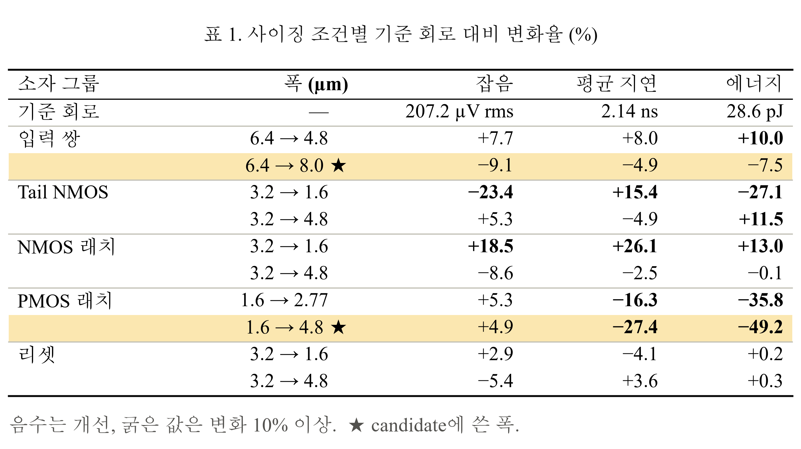
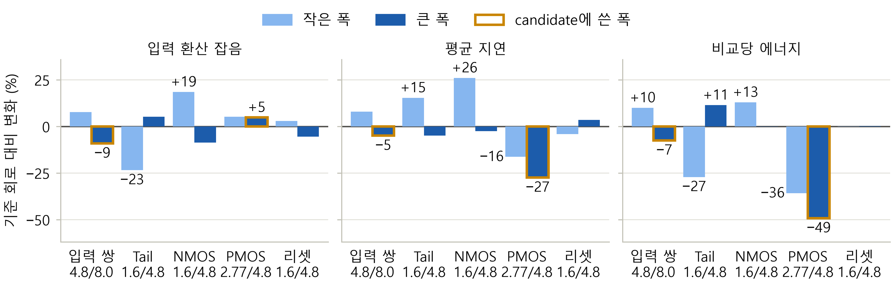
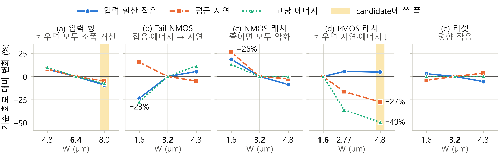
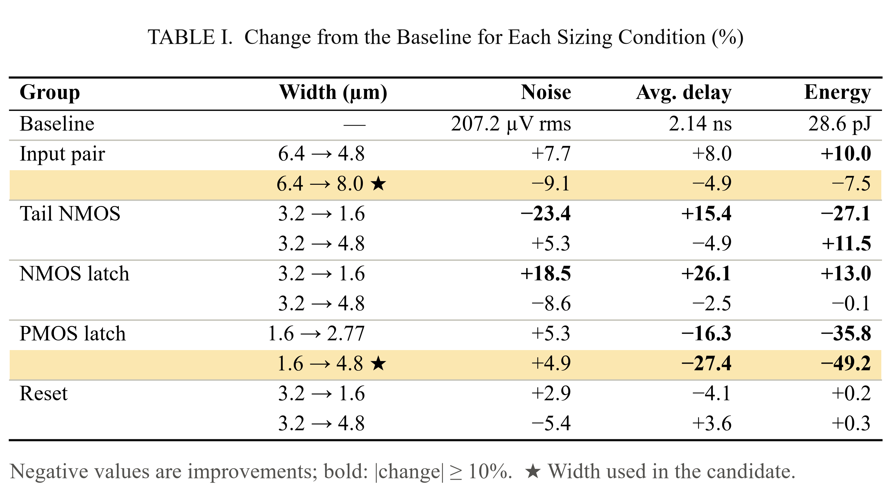
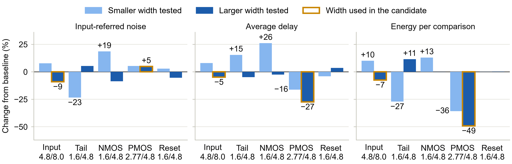
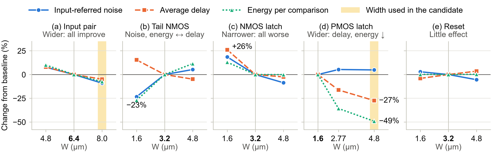

# 그림 2 형식 비교 — 사이징 민감도

세 형식 모두 같은 숫자입니다(사이징 스윕 15개 조건, DIFF 40점 평균, 기준 회로 대비 %). 세 지표(잡음, 평균 지연, 에너지) 모두 **작을수록 좋으므로 음수가 개선**입니다.

다시 그리기: `cd sim_result` → `python fig2_sizing_sensitivity.py`

| | 1. 숫자 표 | 2. 지표별 막대그래프 | 3. 트랜지스터별 그래프 + 요약 |
|---|---|---|---|
| 한 줄 설명 | 행 = 무엇을 몇 µm로 바꿨나, 열 = 세 지표의 % 변화 | 지표마다 패널 하나, 그룹마다 작은 폭·큰 폭 막대 두 개 | 트랜지스터마다 패널 하나, 실제 폭에 따른 세 지표 선 |
| 장점 | 해석이 필요 없음. 정확한 숫자가 다 보임 | "어느 소자가 가장 크게 바꾸나"가 막대 길이로 바로 보임 | 패널 제목 아래 한 줄 요약으로 결론을 먼저 읽음 |
| 단점 | 경향(크기 비교)은 숫자를 읽어야 보임 | 그룹마다 폭 값이 달라 축 아래 숫자를 함께 봐야 함 | 한 패널에 선이 셋이라 처음엔 범례를 확인해야 함 |
| 논문에서 | 그림 2 대신 **표**가 됨 (표 번호가 하나씩 밀림) | 그림 2 | 그림 2 |
| 크기 (본문 폭 기준) | 약 117 × 62 mm (Word 표로 넣으면 더 작아짐) | 178 × 57 mm | 178 × 56 mm |

---

## 1. 숫자 표

고르시면 이미지 대신 양식 서식의 **Word 표**로 넣어 드립니다.

## 2. 지표별 막대그래프

## 3. 트랜지스터별 그래프 + 한 줄 요약

---

## 영문판

