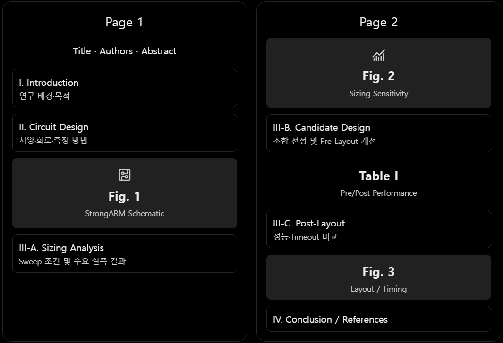

ICEIC 2027 논문 최종 구성안
논문 초안 작성 직전 단계 | 실제 실험 결과 반영 | 2페이지 논문 기준
0. 논문의 기본 방향
제목(안)

Sensitivity-Guided Transistor Sizing and Post-Layout Verification of a StrongARM Comparator for SAR ADC Applications

연구의 핵심: StrongARM Comparator의 소자별 Sizing 민감도를 분석하고, 이를 바탕으로 선정한 조합 Candidate의 성능 개선이 Post-Layout에서도 유지되는지 검증한다.
전체 논리 흐름
I. Introduction

SAR ADC 비교기의 성능 요구 → Sizing 분석의 필요성

II. Circuit Design

응용 사양 설정 → StrongARM Baseline 설계

III-A. Sizing Analysis

5개 그룹 독립 Sweep → 소자별 Trade-off 확인

III-B. Candidate Design

Input Pair + PMOS Latch 조합 → Pre-Layout 개선 확인

III-C. Post-Layout

Baseline과 Candidate의 PEX 성능·Timing 비교

IV. Conclusion

민감도 기반 Sizing 선택의 효과와 한계

논문의 대표 실험 성과
성능 지표	Pre-Layout 개선율	Post-Layout 개선율
평균 Internal Delay	31.11% 감소	17.77% 감소
Energy per Comparison	50.42% 감소	40.76% 감소

모두 실제 측정 결과. Baseline 대비 Candidate의 변화이며, DIFF 40개 지점의 동일 가중치 산술평균.

추가로 Post-Layout에서 최대 관측 Timeout 횟수가 약 100회 → 38회, Invalid 횟수가 약 28회 → 2회로 감소한 것을 그래프로 확인했어.

따라서 논문은 Delay·Energy 개선을 중심 성과로 삼고, Timeout·출력 유효성 개선을 보조 성과로 제시하는 구성이 적절해.
결과 구분
- [실측] 실제 시뮬레이션·CSV로 확인한 값.
- [그래프 판독] 제공한 파형에서 읽은 근삿값.
- [확인 필요] 측정 조건이나 재현성의 추가 검토가 필요한 주장.
- [예상] 앞으로 수행할 실험의 예시 수치. 현재 핵심 실험이 완료되어 별도의 예상 성능값은 넣지 않음.

1. Abstract — 초록
분량: 영문 약 90~110단어 · 1문단

작성 순서

1. 연구 목적
- SAR ADC용 StrongARM Comparator의 Transistor Sizing에 따른 성능 민감도 분석.
2. 연구 방법
- 500 nm CMOS 기반 StrongARM + SR Latch 설계.
- 5개 소자 그룹의 Width Sweep.
- 분석 결과에 따라 Input Pair와 PMOS Latch를 조합한 Candidate 선정.
- Baseline/Candidate의 Pre/Post-Layout 성능 비교.
3. 핵심 실험 결과
- Pre-Layout: Delay 31.11%, Energy 50.42% 감소.
- Post-Layout: Delay 17.77%, Energy 40.76% 감소.
- Post-Layout에서도 5 ns Timeout과 Invalid 발생 횟수 감소.
4. 연구 결론
- 소자별 Sizing 민감도 분석을 기반으로 한 설계 개선 효과가 기생성분 추출 후에도 유지됨을 확인.

2. I. Introduction — 서론
2개 문단 · 약 10~15%
문단 1. 연구 배경 및 필요성
- SAR ADC는 반복적인 비교를 통해 디지털 출력을 결정함.
- Comparator의 Noise·Offset·Delay·Energy가 정확도와 동작 효율에 영향을 미침.
- StrongARM Latch는 정적 전력 소비가 없는 동적 비교기 구조로 SAR ADC에 활용됨 [1], [2].
- 트랜지스터 크기는 구동 능력, Regeneration 및 기생 커패시턴스에 영향을 미침.
- 따라서 주요 소자 그룹의 Sizing에 따른 성능 민감도를 분석할 필요가 있음 [2], [3].
문단 2. 연구 목적 및 접근 방법
- 실제 10-bit, 1-MS/s SAR ADC 연구 사례 [4]를 응용 조건의 근거로 활용.
- StrongARM Comparator의 5개 소자 그룹을 독립적으로 Sweep.
- Noise·Delay·Energy 사이의 Trade-off 분석.
- 유리한 Sizing 조건을 조합하여 Candidate 설계.
- Candidate의 Pre-Layout 성능을 확인하고, Baseline과 Post-Layout 결과를 비교.
서론의 결론

- 본 연구는 개별 Sizing 분석에 그치지 않고, 분석 결과를 설계에 적용하고 물리적 구현 이후까지 검증하는 것을 목표로 함.

3. II. Circuit Design and Specifications — 회로 설계
2~3개 문단 + Fig. 1 · 약 20%
문단 1. 응용 가정 및 목표 사양
- 기존 10-bit, 1-MS/s SAR ADC 구현 사례 [4]를 참고.
- 500 nm CMOS, VDD = 5 V, VCM = 2.5 V 사용.
- 차동 Full-scale 입력 범위 2.5 V 가정.
- 10-bit 기준 1 LSB = 2.441 mV.
- Nominal Decision Center 목표: \(|\mu|\leq1.221\) mV (0.5 LSB).
- Input-referred Noise 목표: \(\sigma\leq244.14\) µV RMS (0.1 LSB).
- 80 MHz Clock, 50% Duty를 별도 시험 조건으로 설정.
- Rising Edge 이후 5 ns를 내부 판정 마감 기준으로 설정.
사양 근거의 구분
- 10-bit, 1-MS/s: 문헌 [4]의 실제 응용 사례.
- Full-scale 2.5 V, Noise 0.1 LSB, 판정 중심 0.5 LSB: 본 연구의 설계 가정 및 예산.
- 80 MHz / 5 ns: 1-MS/s SAR ADC에서 필수로 도출한 값이 아닌 별도 Comparator 평가 조건.
문단 2. StrongARM 회로 구성
- StrongARM Core + SR Latch로 구성.
- Reset 단계: 내부 노드 초기화.
- Evaluation 단계: 차동 입력 감지 및 Regeneration.
- SR Latch: 비교 결과 유지.
- Input Pair, Tail NMOS, NMOS Latch, PMOS Latch, Reset 그룹의 Width를 설계 변수로 선정.
- Channel Length는 0.5 µm로 고정.
Baseline Transistor Width
그룹	Width (µm)
Input Pair	6.4
Tail NMOS	3.2
NMOS Latch	3.2
PMOS Latch	1.6
Reset P/Q 및 X/Y	3.2

Fig. 1. Schematic of the StrongARM Comparator
- StrongARM Core 및 SR Latch 회로도.
- 5개 Sizing 그룹 표시.
- Candidate에서 변경한 Input Pair와 PMOS Latch 강조.
배치: Section II 아래 또는 옆 열. 회로 구조 및 Sizing 대상을 설명하는 그림.

문단 3. 시뮬레이션 및 성능 평가 방법
- DIFF = −1.2~+1.2 mV, 40개 지점.
- 각 DIFF에서 100회 비교.
- Transient Noise를 적용한 High 판정 확률의 Gaussian CDF 피팅.
- CDF 평균 μ를 명목 판정 중심, 표준편차 σ를 Input-referred Noise로 추출.
- 내부 판정 완료 시간으로 Delay 측정.
- 공급 평균 전력으로 Clock 주기당 Energy 계산.
- Delay·Energy는 DIFF 40개 지점의 동일 가중치 산술평균 사용.
- 5 ns Timeout과 CLK Falling 시점의 내부 판정·SR Latch 출력 일치 여부를 추가 평가.

4. III. Simulation Results and Discussion — 결과 및 분석
3개 소절 · 약 45~50%
III-A. Transistor Sizing Sensitivity Analysis
문단 1. 독립 Sizing Sweep
- 5개 소자 그룹별 3개 Width, 총 15개 시뮬레이션 조건.
- 하나의 그룹만 변경하고 나머지는 Baseline 유지.
- 각 조건의 Noise·Delay·Energy를 Baseline과 비교.
Sizing 조건
그룹	Width (µm)
Input Pair	4.8 / 6.4 / 8.0
Tail NMOS	1.6 / 3.2 / 4.8
NMOS Latch	1.6 / 3.2 / 4.8
PMOS Latch	1.6 / 2.771 / 4.8
Reset	1.6 / 3.2 / 4.8

굵은 값은 Baseline. Reset P/Q 및 X/Y는 동시에 변경.
문단 2. Sizing 분석의 실제 결과
변경 조건	Noise 변화	평균 Delay 변화	Energy 변화
Input 6.4 → 8.0	−9.1%	−4.9%	−7.5%
Tail 3.2 → 1.6	−23.4%	'+15.4%	−27.1%
NMOS Latch 3.2 → 1.6	'+18.5%	'+26.1%	'+13.0%
PMOS Latch 1.6 → 4.8	'+4.9%	−27.4%	−49.2%
Reset 3.2 → 4.8	−5.4%	'+3.6%	'+0.3%

[실측] 최초 개별 Sizing Sweep 기준. Width 단위는 µm.

결과 해석 순서
1. PMOS Latch: Width 증가 시 Delay·Energy의 가장 큰 개선 확인.
2. Tail NMOS: Noise·Energy 개선과 Delay 증가의 Trade-off 확인.
3. NMOS Latch: 과도한 Width 감소가 Noise·Delay·Energy를 모두 악화.
4. Input Pair: Width 증가 시 Noise·평균 Delay·Energy 개선.
5. Reset: 상대적으로 낮은 Energy 민감도 확인.
6. 모든 조건에서 Nominal Decision Center \(|\mu|\)가 15.4 µV 이내로 나타나 설정 목표 만족.
소절 결론
- PMOS Latch와 Input Pair의 Width 증가를 조합 Candidate에 적용하기로 결정.
- 개별 결과가 단순히 합산된다고 가정하지 않고 조합 회로를 재평가.
Fig. 2. Transistor Sizing Sensitivity
- (a) Normalized Input-referred Noise
- (b) Normalized Average Delay
- (c) Normalized Energy per Comparison
- 각 성능을 해당 Baseline = 1로 정규화.
- 5개 그룹의 3개 Sizing 조건 표시.
배치: III-A. 이번 연구의 Sizing 분석 결과를 보여주는 가장 중요한 그림.

III-B. Sensitivity-Guided Candidate Design
문단 1. Candidate 선정
- 개별 분석 결과에서 PMOS Latch와 Input Pair의 Width 증가가 유리하게 나타남.
- 다음과 같이 두 그룹을 조합하여 Candidate 구성.
그룹	Baseline	Candidate
Input Pair	6.4	8.0
Tail NMOS	3.2	3.2
NMOS Latch	3.2	3.2
PMOS Latch	1.6	4.8
Reset	3.2	3.2

단위: µm.
문단 2. Candidate Pre-Layout 결과
[실측] 동일 DIFF 40개 지점에서 비교한 Baseline과 Candidate
항목	Baseline	Candidate	변화
μ (µV)	13.061	12.190	목표 만족
σ (µV RMS)	206.440	201.476	−2.40%
평균 Delay (ns)	2.13656	1.47185	−31.11%
E_comp (pJ)	28.6464	14.2020	−50.42%

해석 순서
1. Candidate에서 설정한 Nominal Decision Center 및 Noise 목표 유지.
2. 평균 Delay 31.11% 감소.
3. Energy per Comparison 50.42% 감소.
4. 최대 관측 Delay도 약 3.83 ns → 2.17 ns로 감소.
5. Candidate 실행에서는 Timeout 및 Invalid 미관측.
소절 결론
- 개별 Sizing 분석 결과를 기반으로 설계한 조합이 실제로 평균 Delay와 Energy를 개선함.
- 이를 Post-Layout 비교 대상으로 선정함.
Noise의 2.40% 감소는 관측값으로만 제시. Seed에 따른 변동이 확인되었으므로 통계적으로 확정된 개선 효과로 강조하지 않음.

III-C. Post-Layout Verification
문단 1. Layout 구현 및 비교 조건
- Baseline과 Candidate StrongARM Core Layout 구현.
- 기생 저항·커패시턴스·Coupling Capacitance를 포함한 PEX 시뮬레이션 수행.
- SR Latch는 두 조건에서 동일한 Schematic 사용.
- 동일한 Clock, DIFF Sweep 및 측정 방법으로 두 회로 비교.
- Layout Area 비교는 연구 범위에서 제외.
문단 2. Post-Layout 성능 비교
논문 핵심 결과 표 — Table I
항목	Pre: Baseline	Pre: Candidate	Post: Baseline	Post: Candidate
μ (µV)	13.061	12.190	248.624	18.594
σ (µV RMS)	206.440	201.476	95.927	60.016
Avg. Delay (ns)	2.1366	1.4719	5.0227	4.1304
E_comp (pJ)	28.646	14.202	54.537	32.305

모두 [실측]. Post-Layout CDF 수치는 가장 최근 Baseline 및 Candidate 측정 결과 사용. 과거 별도 실행의 Baseline μ = 177.292 µV, σ = 123.262 µV와 혼용하지 않음.

Table I이 전달하는 메시지
- Candidate의 Delay·Energy 개선이 Pre-Layout에 국한되지 않고 Post-Layout에서도 유지됨.
- 기생성분을 반영하면 두 회로의 절대 Delay·Energy가 증가하며, 상대 개선 폭도 달라짐.
문단 3. Delay·Energy 변화 및 Timing 검증
실측 개선율
항목	Pre-Layout	Post-Layout
평균 Delay 감소율	31.11%	17.77%
Energy 감소율	50.42%	40.76%

설명 순서
1. Candidate의 Post-Layout 평균 Delay는 5.0227 → 4.1304 ns로 감소.
2. Energy는 54.537 → 32.305 pJ로 감소.
3. Pre-Layout보다 개선율은 작아졌으나 개선 방향은 유지됨.
4. 판정 경계 부근에서 5 ns Timeout 및 Invalid 발생.
5. Candidate에서 Baseline보다 해당 발생 횟수가 크게 감소.
Post-Layout Timing 결과 [그래프 판독]
항목	Baseline	Candidate
n_timeout 최대	약 100/100	약 38/100
n_invalid 최대	약 28/100	약 2/100
n_valid 최소	약 72/100	약 98/100

- n_timeout: 5 ns까지 내부 판정이 완료되지 않았거나 판정 지연이 5 ns를 초과한 횟수.
- n_invalid: CLK Falling 시점에서 내부 판정 미완료 또는 내부 판정과 SR 출력 불일치 횟수.
- 두 회로 모두 일부 DIFF에서 5 ns Timeout이 발생함.
- 따라서 Candidate의 평균 Delay 개선을 모든 비교가 5 ns 이내에 완료된다는 보장으로 표현하지 않음.
- n_invalid를 입력 극성에 대한 실제 오판정 확률로 표현하지 않음.
Noise 및 Nominal Decision Center 결과
- Post-Layout Baseline: μ = 248.624 µV, σ = 95.927 µV RMS.
- Post-Layout Candidate: μ = 18.594 µV, σ = 60.016 µV RMS.
- 두 회로 모두 설정한 정확도 예산 만족.
- Noise 감소는 관측된 결과이지만, Seed별 변동 및 제한된 CDF 표본 수를 고려하여 물리적 개선의 원인이나 통계적 유의성을 단정하지 않음.
소절 결론
- Candidate의 속도·에너지 개선 효과는 Post-Layout에서도 유지됨.
- 5 ns Timeout과 CLK Falling 시점의 Invalid 발생 역시 감소함.
- 다만 Timing Deadline을 완전히 충족한 설계라고 주장하지 않음.
Fig. 3. Post-Layout Implementation and Timing Comparison
- (a) Baseline과 Candidate Core Layout 이미지.
- (b) 두 회로의 n_timeout vs. DIFF 비교 그래프.
배치: III-C. 지면이 부족하면 Layout 두 이미지만 작게 배치하고 Timeout 최대값은 본문에 수치로 기재. 면적 비교는 하지 않음.

5. IV. Conclusion — 결론
1개 문단 · 약 8~10%

작성 순서

1. 연구 요약
- SAR ADC 응용을 위한 StrongARM Comparator 설계.
- 5개 주요 Transistor 그룹의 Sizing 민감도 분석.
- 분석 결과를 활용한 Candidate 선정 및 Pre/Post-Layout 검증.
2. 개별 Sizing의 대표 결과
- PMOS Latch 증가 시 Delay 27.4%, Energy 49.2% 감소.
- Tail NMOS에서 Noise·Energy와 Delay의 Trade-off 확인.
3. Candidate의 정량적 성과
- Pre-Layout 평균 Delay 31.11%, Energy 50.42% 감소.
- Post-Layout 평균 Delay 17.77%, Energy 40.76% 감소.
4. Timing 검증
- Post-Layout에서도 Deadline 초과 사례가 발생하나 Candidate의 Timeout 및 Invalid 발생 횟수 감소.
5. 연구 의의
- 개별 Sizing 민감도 분석을 실제 설계 후보 선정에 활용.
- 개선 효과가 기생성분을 반영한 구현 이후에도 유지됨을 확인.
- 평균 성능뿐 아니라 판정 마감 조건도 함께 검토할 필요가 있음을 제시.

6. References — 참고문헌
번호	참고문헌	연결 내용
[1]	B. Razavi, The StrongARM Latch, IEEE Solid-State Circuits Magazine, vol. 7, no. 2, pp. 12–17, 2015.  IEEE Xplore	StrongARM 구조와 동작
[2]	B. Razavi, The Design of a Comparator, IEEE Solid-State Circuits Magazine, vol. 12, no. 4, pp. 8–14, 2020.  CoLab	Comparator 설계 Trade-off
[3]	P. Nuzzo et al., Noise Analysis of Regenerative Comparators for Reconfigurable ADC Architectures, IEEE TCAS-I, vol. 55, no. 6, pp. 1441–1454, 2008.  IEEE Xplore	동적 Comparator Noise
[4]	D. Verma et al., A Design of Low-Power 10-bit 1-MS/s Asynchronous SAR ADC for DSRC Application, Electronics, vol. 9, no. 7, 1100, 2020.  mdpi.com	실제 SAR ADC 응용 사례

7. 최종 2페이지 배치

실제 템플릿에 따른 배치는 조정 가능. Fig. 1·2와 Table I을 우선하고 Fig. 3은 공간에 맞춰 축소하는 구성이 현실적이야.
8. 남은 작업 및 확인 사항
이제 핵심 회로 시뮬레이션은 완료됐으므로, 새로운 Sizing 실험보다 결과 정리와 논문 제작이 우선이야.
항목	상태	필요한 작업
5개 그룹 Sizing 분석	완료	Fig. 2 제작
Candidate Pre-Layout 비교	완료	Table I 반영
Baseline/Candidate PEX	완료	Fig. 3 제작
Post-Layout μ·σ	완료	최신 CDF 결과 반영
Post-Layout Delay·Energy	완료	확정된 평균값 반영
Timeout·Invalid 비교	그래프 확보	최대 횟수 수치 확인 및 간단한 그림 정리
DRC/LVS 및 추출 조건	최종 확인 필요	논문에 완료 여부를 명시할 경우 확인
Noise 재현성	추가 검증 보류	관측값 중심으로 서술, 유의성 주장하지 않음
Layout Area 비교	제외	본문에 포함하지 않음
논문 초안	작성 예정	영문 문장화 및 ICEIC 템플릿 편집

특히 Timeout 최대값 100/100, 38/100과 Invalid 최대값 28/100, 2/100은 현재 그래프 판독값이므로, 수치를 정확히 본문에 쓰려면 해당 CSV의 최대값으로 최종 확인하는 것이 좋아.

9. 논문의 최종 핵심 기여
기여	실제 확보한 근거
① Sizing 민감도 분석	5개 그룹의 Noise·Delay·Energy 변화 및 Trade-off 정량화
② 분석 기반 Candidate 선정	Input Pair + PMOS Latch 조합에서 Pre-Layout Delay 31.11%, Energy 50.42% 감소
③ 구현 후 성능 검증	Post-Layout Delay 17.77%, Energy 40.76% 감소
④ Timing 특성 개선 확인	Post-Layout에서 5 ns Timeout 및 Invalid 발생 횟수 감소

최종 논리적 결론
- StrongARM Comparator의 성능 민감도는 소자 그룹에 따라 다르게 나타남.
- 개별 Sizing 분석을 통해 속도·에너지 개선에 유리한 설계 변수를 선정할 수 있음.
- 해당 결과를 조합한 Candidate에서 Pre-Layout 성능 개선을 확인함.
- 기생성분을 포함한 Post-Layout에서도 평균 Delay 17.77%, Energy 40.76% 절감이라는 개선 효과가 유지됨.
- 동시에 5 ns Timeout과 Invalid 발생도 감소했으나, 모든 비교에서 판정 마감이 만족된 것은 아님.
- 따라서 소자별 민감도 분석 → 조합 설계 → Post-Layout 검증이 StrongARM Comparator의 설계 개선에 유효한 접근임을 보여줌.
이 구성을 그대로 사용하면 추가 연구 범위를 넓히지 않고도, 지금 확보한 실제 결과를 바탕으로 2페이지 논문의 일관된 초안을 작성할 수 있어.